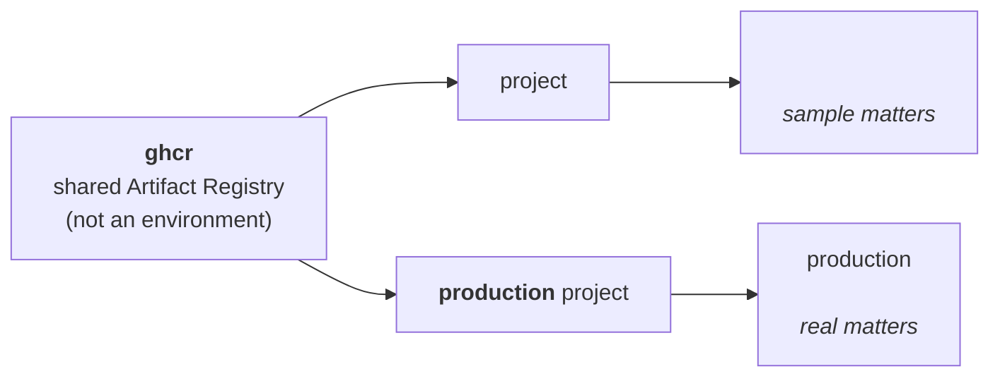

# Environments

Navigator uses one image hub, two runtime Google Cloud projects, and the deployments in the `deployments/` tree — two
live today: `<deployment>` and the production deployment. A deployment—not a project—is the isolation unit: it owns one
store database, four GCS buckets, one GKE Autopilot cluster, one Kubernetes namespace, one runtime Google service
account, one delegated Workspace service-account credential, one `deployments/<name>/` config, one Google Workspace
Drive root, one Restate environment, and one public hostname. A deployment exists because its directory exists.

The tree lives beneath an operator-managed root outside this checkout. Set `NAVIGATOR_DEPLOYMENTS_DIR` before running
commands; see [`deployment-secrets`](deployment-secrets.md).

`<deployment>` is the one persistent staging deployment, and **it is the only deployment that holds sample matters.**
Every case, client, document, and workshop roster in it is synthetic; no real person's matter is ever seeded there, and
production never carries sample data in the other direction. That boundary is what makes staging safe to reset, demo,
and screenshot.

Its deployment identity is staging, but its runtime profile is `production`: it runs `<deployment>` over that sample
plane and exercises the same root-mounted `portal` application, database access, authorization, APIs, and agent
protocols the brand binary composes. Staging and production stay separate deployments because one holds synthetic
matters and the other holds real ones; their public route tables are covered before release by the brand router and
browser suites.

## Canonical deployment matrix

Every value in the resource columns is also the corresponding `config.toml` coordinate. `NAVIGATOR_GCP_LOCATION` is
intentionally omitted from the table because it is chosen per installation; use the same region for a row's buckets and
cluster.

| Deployment | GCP project | Public host | Matters | Image | Resource prefix |
| --- | --- | --- | --- | --- | --- |
| `<deployment>` | `<deployment>` | `<deployment>` | sample | `<deployment>` | `<deployment>` |
| production | its own project | configured host | real | `<deployment>` | deployment name |

| Deployment | Brand host |
| --- | --- |
| `<deployment>` | `staging.deleteyourdata.com` |
| `<deployment>` | `staging.lawyershook.com` |
| the production deployment | its configured brand hosts |

Each row also serves a workflows host beside its public one: `workflows-<deployment>` for `<deployment>` and
`<deployment>` for production. Both are set per deployment as `NAVIGATOR_PUBLIC_HOST` and `NAVIGATOR_WORKFLOWS_HOST`.

**One production.** One deployment serves real matters, and `<deployment>` is the only public host that reaches them.
Staging carries a public name so a link to it resolves. Its perimeter is the tailnet allowlist, which keeps the human
surface private while the public workflows host remains reachable by external machine callers.

Production is a rollable deployment. Its `deployments/<name>/` directory carries both `config.toml` and
`secrets.enc.yaml`. `release-deploy.yml` rolls each stable release onto it after staging passes its health checks, and
holds every prerelease at staging; see [`release-automation.md`](release-automation.md). A Deployment Operator rolls it
by hand with [`manual-roll.md`](manual-roll.md).

Its substrate is provisioned in its own project under its own prefix: the Autopilot cluster and the
`<prefix>-gateway-ip` global address. The store is a hosted SurrealDB instance provisioned at the store provider, not by
this repository. The gateway address is a deployment coordinate, not a fact about Navigator: it lives in the
deployment's `config.toml` as `NAVIGATOR_GATEWAY_IP`, and `gcloud compute addresses describe <prefix>-gateway-ip
--global --format='value(address)'` prints the current value.

`<deployment>` and `<deployment>` both resolve to that address and are served by this deployment's Ingress, each with
its own `ManagedCertificate` Active, and every other registered brand host the same way — the release inventory covers
all of them, launched or not; see [`dns.md`'s Grounding TLS in the release
inventory](dns.md#grounding-tls-in-the-release-inventory). This deployment's Ingress serves the complete public route
table at `<deployment>`; there is no separate marketing-site deployment or publishing tool.

Each deployment serves its own host, and the host says what the deployment is. `<deployment>` is production: the firm at
the root, over real matters. Staging serves `<deployment>` over sample data, so a visitor never has to guess which one
they reached. `neon` is the identifier that names the GCP projects `<deployment>` and production and the image
`<deployment>`; the public brand lives only in the domain. Each row's Workspace is in the Drive table under [Matter
storage](#matter-storage-and-workspace-attachment).

For a resource prefix `<name>`, set:

| Variable | Value |
| --- | --- |
| `NAVIGATOR_GKE_CLUSTER_NAME` | `<name>` |
| `NAVIGATOR_GKE_CONTEXT` | `gke_<project>_<region>_<name>` |
| `NAVIGATOR_K8S_NAMESPACE` | `<name>` |
| `NAVIGATOR_VPC_NAME` | `<name>-vpc` |
| `NAVIGATOR_SUBNETWORK_NAME` | `<name>-subnet` |
| `NAVIGATOR_GATEWAY_IP_NAME` | `<name>-gateway-ip` |
| `NAVIGATOR_ASSETS_BUCKET` | `<name>-assets` |
| `NAVIGATOR_DOCUMENTS_BUCKET` | `<name>-documents` |
| `NAVIGATOR_EXPORTS_BUCKET` | `<name>-exports` |
| `NAVIGATOR_LOGS_BUCKET` | `<name>-logs` |
| `NAVIGATOR_GCP_SERVICE_ACCOUNT_ID` | `<name>-web` |
| `NAVIGATOR_DRIVE_GCP_SERVICE_ACCOUNT_ID` | `<name>-drive` |
| `NAVIGATOR_WEB_SECRET_NAME` | `<name>-web-secrets` |

Bucket names are globally scoped in GCS. If one of these short names is already taken, add a stable organization prefix
to all four bucket names; do not change the deployment prefix used for other resources.

`NAVIGATOR_PUBLIC_HOST` is the exact public host in the matrix, and `NAVIGATOR_WORKFLOWS_HOST` is the workflows host
beside it: `<deployment>` for production, `workflows-<deployment>` for `<deployment>`. Both rows sit on `<deployment>`,
and staging's names are a subdomain and a hyphenated sibling rather than a separate domain, so a deployment never
borrows another row's host. Set `NAV_BASE_URL` to `https://$NAVIGATOR_PUBLIC_HOST`, `NAVIGATOR_WORKFLOWS_URL` to
`https://$NAVIGATOR_WORKFLOWS_HOST/`, and `NAVIGATOR_ASSET_BASE_URL` to `$NAV_BASE_URL/assets`. The backing GCS bucket
remains private; the application reads it through Workload Identity and serves this bounded public marketing lane at the
same origin. `ops ship` derives the web pod's `CANONICAL_HOST` from `NAVIGATOR_PUBLIC_HOST`. Set
`NAVIGATOR_PRIMARY_DOMAIN` to that same host for Restate registration; otherwise canonical-host middleware or Restate
registration can silently target a different site.

`NAVIGATOR_SUMMARY_ENVELOPE_RECIPIENTS` is the inbound-summary SMTP allowlist, set per row in the Deploy repository.
Each row names the final recipient SendGrid Inbound Parse receives after any Google Workspace routing rewrite (normally
the row's Parse intake address), not the visible `To:` header or original support mailbox. Unset leaves that lane off; a
present blank value fails boot. There is no compiled default.

`NAVIGATOR_SUMMARY_ENABLED=true` opts a row into the durable review lane. It also requires `NAVIGATOR_DEPLOYMENT_ID`,
`NAVIGATOR_SUMMARY_CHANNEL_ID`, `SENDGRID_INBOUND_PUBLIC_KEY`, the row's HTTPS `RESTATE_BROKER_URL`, and
`NAVIGATOR_GCP_PROJECT_ID`; web and `workflows-service` must receive the same gate and coordinates. The GCP project must
have Vertex AI enabled and the runtime service account must have `roles/aiplatform.user`. Model, location, and
input/output limits have shared defaults and can be overridden per row. `NAVIGATOR_SUMMARY_FIRM_ID` is an optional
override; unset, web files each receipt under the Firm wearing the `neon` brand. `NAVIGATOR_SUMMARY_PROVIDER_ACCOUNT`
defaults to `sendgrid`. `navigator ops deployments` refuses a row that enables the lane without every key it boots with.
Gemini is the only summary provider. Claude was removed on 2026-09-24 because Vertex Model Garden granted the deployment
projects no request quota for `anthropic-claude-haiku-4-5` and refused the self-serve increase for lack of usage
history; restoring it means a quota grant first, then the adapter from git history.

The `EmailSummary` workflow gates the model on the sender: its `check-sender` step looks up the `From:` address, or a
text's phone number, in `person` (a phone matches ignoring punctuation and a leading US `1`). A known person gets the
Gemini summary; anyone else, or a message with no readable sender, gets a "summary skipped" reason and no Vertex call.
Either way the full body follows as a thread reply under the Slack post. The channel is `NAVIGATOR_SUMMARY_CHANNEL_ID`
per row: `#messages` in production, `#staging-messages` in staging.

Every hosted row uses `NAVIGATOR_ENVIRONMENT=production` and `NAVIGATOR_CREDENTIAL_ENVIRONMENT=production`.
`<deployment>` remains the proving release ring through its config, namespace, data plane, and hostname—not through a
weaker runtime profile. The same `NAVIGATOR_SIMULATED_MATTERS=true` coordinate that discloses the synthetic data plane
also appends a final `from Staging` line to every Slack body that deployment posts (ops webhook, Project-channel bot,
and Firm-private notices). Restate jobs do not rewrite their bodies with a second staging parenthetical. Local KIND is
`NAVIGATOR_ENVIRONMENT=dev` and does not. Set `GOOGLE_OAUTH_REQUIRED_HD=<deployment>` on both rows. This value is the
selected Workspace login domain, not necessarily the site's public hostname.

The login domain names one Workspace tenant. An identity in another organization's Workspace holds none here, which is
why the value is the selected login domain rather than the site's public hostname.

## Replicas

Every hosted row gets the same GKE setup; only the pod count differs, and `navigator ops ship` reads it from
`NAVIGATOR_SIMULATED_MATTERS` in the row's `config.toml`:

| `NAVIGATOR_SIMULATED_MATTERS` | `navigator-web` | `workflows-service` | PodDisruptionBudget |
| --- | --- | --- | --- |
| `"true"` (staging) | 1 | 1 | none |
| `"false"` or unset (production) | 2 | 2 | `minAvailable: 1` for each |

Any other value stops the ship before render. A one-pod row carries no budget, because `minAvailable: 1` over one pod
would block every node drain. `web` rolls with a surge pod (`maxSurge: 1`, `maxUnavailable: 0`) on either row. The
worker keeps `maxSurge: 0`, so at two pods it replaces one pod at a time.

Two pods are safe on both tiers. `web` keeps no single-writer disk: its `NAVIGATOR_GIT_REPO_ROOT` directory is per-pod
scratch (`emptyDir`). Project repositories live on the forge, so nothing in `web` commits there. The Restate handlers in
`workflows-service` are stateless HTTP. Each DBOS host takes its pod name as `NAVIGATOR_DBOS_EXECUTOR_ID`, and every
schedule keys its workflow id on its slot, so a second pod joins the same scheduled run instead of starting another one.
See [DBOS durability](dbos-durability.md#several-replicas).

## Why the brand is the image

`<deployment>` is built from the `neon` brand crate, and the crate is what composes the public routes for every house
brand this repository registers — the deployment config selects one allow-listed image name, and `navigator ops ship`
pins all runtime images to one immutable release tag. There is no runtime *image* switch, but there is a runtime *host*
switch: which house brand a request renders is resolved per request from its `Host:` header against the compiled
registry (`views::brand::BrandKey`, see [`glossary/`](glossary/brand.md)), not from a deployment-level flag. A
misconfigured deployment cannot serve one entity's pages under another entity's tag, because the served-host list for
each key is compiled in rather than read from config.

Staging and production keep their own data planes. A reset, secret rotation, version rollback, or failed certificate in
one row cannot cross a database, bucket, cluster, runtime principal, or Restate journal boundary. Staging proves the
shared application through its sample-matter lane, while the build and route suites prove both public faces the one
image serves.

## Matter storage and Workspace attachment

GCS and Google Drive are separate lanes:

- The deployment's private documents bucket is the canonical client-asset store. Navigator authorizes it through the
  Project row and participation checks; clients never receive bucket IAM.
- The deployment's Workspace Drive root contains the firm's internal per-matter working folders. Folder permissions
  reconcile from firm-side Project participation.

Each row has a distinct Drive root. Staging attaches to the Neon Law-controlled Workspace under a root of its own, and
the firm production root is separate as well. The selected Drive root never crosses deployments.

`cloud::drive`'s `DriveWorkspace` and `cloud::workspace`'s `GoogleWorkspace` each carry a single variant, `NeonLaw`, so
a deployment resolves both its shared-drive and root-folder keys against the firm's `NAVIGATOR_DRIVE_NEON_LAW_*` prefix.
The unreached second variant that used to sit beside it — a nonprofit attachment nothing in the running code ever
reached — is gone.

The selected Workspace block in each deployment's config is:

| Deployment | Required Drive variables |
| --- | --- |
| `<deployment>` | shared Drive ID + staging Projects root ID |
| the production deployment | shared Drive ID + production Projects root ID |

Every deployment supplies `NAVIGATOR_DRIVE_NEON_LAW_PROJECTS_DRIVE_ID` and its selected root ID:
`NAVIGATOR_DRIVE_NEON_LAW_STAGING_PROJECTS_ROOT_FOLDER_ID` or
`NAVIGATOR_DRIVE_NEON_LAW_PRODUCTION_PROJECTS_ROOT_FOLDER_ID`. The common Neon Law Workspace credentials remain
`NAVIGATOR_DRIVE_NEON_LAW_DELEGATED_USER` and `NAVIGATOR_DRIVE_NEON_LAW_SERVICE_ACCOUNT_JSON`. Drive ingest is optional:
a deployment that sets none of these four keys has it disabled, and `navigator project doctor` reports that as a
warning. Setting some but not all is a misconfiguration the doctor reports with every missing key at once. No local
Drive mount is read. Workspace Admin domain-wide delegation is global rather than regional and remains a one-time
administrative prerequisite; the regional GCP provisioner cannot grant it.

## Project ownership

`ghcr` is the shared image hub and must never receive GKE or workload buckets. The two runtime projects are:

- `<deployment>` — the one persistent staging deployment, serving its own host over sample matters.
- the production deployment — serving `<deployment>` over real client matters.

Project IDs are immutable. Organization moves preserve the project ID and project number, so project-level IAM is the
portable boundary. Avoid relying on organization-inherited IAM for a project that may move. The registry grants each
runtime project's node identity repository-scoped reader access.

That reader grant is the one binding a move does break, and it breaks in the hub rather than in the moved project. It is
written against `ghcr`, so once a runtime project sits in a different organization its node identity is a foreign
principal there, and the write is evaluated against `constraints/iam.allowedPolicyMemberDomains` — domain restricted
sharing. If the hub's organization does not allow the moved project's directory, the binding is refused and that
deployment cannot pull an image; a routine `ops gcp setup` re-run is refused for the same reason. `ops gcp setup`
reports this as `SetupError::OrgPolicyRefused` rather than a bare 403. Allow the directory on the hub's organization
**before** moving a project, not after.

## See also

- [`Operating Neon Law Navigator`](../server/content/workshops/navigator/DEPLOY.md) — exact provision, secret-audit,
  DNS, version-pin, and verification commands.
- [`cloud-operations`](cloud-operations.md) — the operator boundary.
- [`deployment-secrets`](deployment-secrets.md) — the `deployments/` tree: coordinates, SOPS key material, and apply.
- [`dns`](dns.md) — idempotent DNSimple reconciliation.
- [`gitops`](gitops.md) — release creation and the ordered per-deployment rollout.
