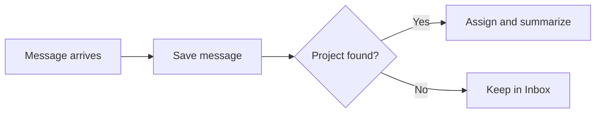

# Frontmatter: the cover sheet on every file

This page is for the attorney who is about to write or edit a file in Neon Law Navigator — a notation template, a blog
post, or a workshop — and wants to know what the little block at the top is for. You do not need to be a programmer to
read it. You need to know which label goes on which document, and what each line means.

## You cannot quietly ship a broken document

Start here, because it is the part that protects you. Every file is checked as you type, in your editor, against the
same rules the project enforces everywhere else. If you leave out something a document needs — a title, the attorney
review step, the second half of a pair — the editor underlines it in **red** before the file ever leaves your screen.
You are caught at your desk, not in production and not in front of a client. The rest of this page is just *what* the
checker is looking for.

## Mermaid diagrams

Markdown posts, glossary pages, and workshop slides render a `mermaid` fence as a diagram:



The viewer keeps the source text under **Diagram source**, with the code-copy control. Invalid diagrams or a failed
renderer show their source. Rendering runs in a sandboxed frame using pinned, same-origin assets; it sends no diagram
text to a third-party service. The frame blocks network requests, external images, forms, and access to the parent page.

## What frontmatter is

Most files in Neon Law Navigator are plain text, and many of them begin with a small block fenced top and bottom by a
line of three dashes (`---`). The block holds a few `key: value` lines, like this:

```yaml
title: Onboarding Letter
```

That block is the **frontmatter** (the real file has a `---` line above and below it). Think of it as the caption on a
pleading: a short, structured label that tells the system *what kind of document this is* and the handful of facts it
needs to file it correctly. Everything below the block is the document itself — the prose you write and, in the end,
sign.

The format is called YAML, but it is nothing more than `key: value`, one per line. There is no programming. Spell the
key correctly on the left, put a valid value on the right, and keep the indentation the examples show. When something is
wrong, the editor underlines it — the same way a word processor underlines a misspelling.

## The kinds of file, and what each one declares

You say what a file is by **declaring it**: a `kind:` key names the file's kind outright, and that declaration is the
*only* classifier — the system never guesses the kind from a file's structure or its path. Its value is one of a small,
fixed vocabulary. Most values name notation-template kinds — `letter`, `filing`, `will`, `trust`, `directive`,
`agreement`, `pleading`, `onboarding`, `offboarding`, `memo` — some name content pages — `post`, `workshop` — and one,
`github`, names the engineering intake notations. Anything else is a blocking error (`S103`), including a matter page
kind: a matter page is a `pages:` entry in a Project's `navigator.yaml` (see [the
gate](gate.md#declaring-a-matter-page)), never a Markdown file. The vocabulary grows as the firm's practice areas do.

A file that declares no `kind:` is ordinary prose, held only to general writing rules. Because classification is
declaration-only, a file that carries notation *structure* — a `questionnaire:`/`workflow:` block — but forgets its
`kind:` is a blocking error (`S104`): it would otherwise lint silently as prose and skip its whole rule family. Each
kind and the keys it must carry:

- **Notation template** — one of the notation kinds (`letter`, `filing`, `will`, `trust`, `directive`, `agreement`,
  `pleading`, `onboarding`, `offboarding`, `memo`). A complete one carries **both** the `questionnaire:` and `workflow:`
  machines plus `title`, `code`, `respondent_type`, `jurisdiction`, and `confidential`, and the missing ones are
  flagged. Lives under `templates/notations/forms/` or `templates/notations/neon_law/`; a `templates/` file with no
  `kind:` is just prose until it declares one.
- **Blog post** — `kind: post`. Posts are no longer Markdown files in Git: they are rows in the `blog_post` table,
  seeded from `store/seeds/neon/Post.yaml`. The rules below still check any `kind: post` file you write.
- **Workshop page** — `kind: workshop`. Lives under `server/content/workshops/`. Needs `title` and `description`.
- **GitHub notation** — `kind: github`. Lives at `templates/github/create_issue.md` or
  `templates/github/create_pull_request.md`, and nowhere else. Needs `title` and a `questionnaire:`, and its body
  renders the answers into the issue or pull request text. It declares **no** `workflow:`, `code`, `jurisdiction`,
  `respondent_type`, or `confidential` — it is engineering intake, not legal work, so the legal contract has nothing to
  check. `N119` pins the whole shelf; see [the templates README](../templates/README.md).
- **Everything else** — ordinary prose (READMEs, docs). No frontmatter is required.

Workshop and presentation bodies use one shared outline contract. A top-level `#` names the material, each `##` starts a
chapter, and each `###` starts one section/slide inside that chapter. Prose between a chapter heading and its first
section is the chapter preamble, rendered on the public overview without becoming a numbered slide. Put the slide face
above a `---` thematic break and its presenter notes below. Every deck begins with an `## Intro` chapter and ends with
an `## Wrap Up` chapter; the public overview and light table group sections by those chapter headings while playback
keeps one stable section order.

Legal motions and contracts use a **Harvard outline**, not the workshop chapter/slide tree. Depth-1 headings are Roman
(`## I. Title`) on contracts and closing letters, or Arabic (`## 1. Title`) in motion practice. Lettered subsections are
block quotes (`> **A. Label.** …`) so the PDF conversion indents them. `N123` enforces the depth-1 scheme on the kinds
that must carry an outline (`agreement`, `will`, `pleading`, `offboarding`). A matter's notation narrates on that stage
at `/app/projects/{code}/{notation_id}/outline`.

## Notation templates — the legal blueprints

A notation template is the document a client eventually signs, plus the questions that fill it in and the path it walks
to get there. Here is the real frontmatter from the shared onboarding letter,
`templates/notations/neon_law/onboarding__letter.md` (shown without its surrounding `---` fences):

```yaml
kind: onboarding
title: Onboarding Letter
respondent_type: person_and_entity
jurisdiction: NV
confidential: true
output: letter
prompts:
  client_name: Who is the Client's directly responsible individual, the one person the Firm takes instructions from?
  project_name: What is the project name for this engagement?
  engagement_scope: >-
    In a sentence or two, what is the minimum scope of this engagement.
  engagement_start_date: When does this engagement begin?
  governing_law: >-
    Which state's law governs this engagement? Nevada, unless the Firm has
    agreed otherwise; California and Washington are the alternatives available.
audiences:
  governing_law: lawyer
  engagement_start_date: lawyer
  engagement_scope: lawyer
choices:
  governing_law:
    nevada: Nevada
    california: California
    washington: Washington
questionnaire:
  BEGIN:                                     { _: entity }
  entity:                                    { _: address__principal_office }
  address__principal_office:                 { _: person__client }
  person__client:                            { _: project__engagement }
  project__engagement:                       { _: custom_datetime__engagement_start_date }
  custom_datetime__engagement_start_date:    { _: custom_text__engagement_scope }
  custom_text__engagement_scope:             { _: custom_single_choice__governing_law }
  custom_single_choice__governing_law:       { _: END }
  END: {}
workflow:
  BEGIN:                        { intake_submitted: intake_persisted__client }
  intake_persisted__client:     { retainer_rendered: lawyer_review }
  lawyer_review:                 { approved: generate_pdf__retainer_pdf, changes_requested: reask__client, rejected: END }
  reask__client:                 { intake_resubmitted: lawyer_review }
  generate_pdf__retainer_pdf:  { pdf_persisted: sent_for_signature__pending }
  sent_for_signature__pending:  { signature_received: END, signature_declined: END }
  END: {}
```

Each key, in plain English:

- **`kind`** — what this notation is: `onboarding` (the letter that opens a matter), `offboarding` (the closing letter),
  `letter` (a letter the firm sends on the client's behalf), `filing` (a document filed with a government body),
  `pleading` (court paper — a complaint, motion, or brief), `will`, `trust`, `directive`, `agreement`, or `memo`. It is
  **required** on every notation template — the declared kind is the sole classifier, so a template without it lints as
  prose — and an unrecognized value is a blocking error.
- **`title`** — the human name of the document, e.g. `Onboarding Letter`. It cannot be blank.
- **Filename stem** — the document's permanent file number, in `snake_case` (e.g. `onboarding__letter`). It must be
  unique across the whole project, and you do not change it once clients have signed under it. The stem is how a signed
  document is traced back to the blueprint it came from, so changing it later would cut the audit trail your malpractice
  carrier may one day need to read. A mismatched legacy `code:` warns through release `26.9.29` and is removed by
  `navigator validate --fix`; later releases reject any remaining `code:` key.
- **`respondent_type`** — who signs: `person`, `entity`, or `person_and_entity`. Nothing else is accepted.
- **`jurisdiction`** — the state whose law governs: `NV`, `CA`, or `US`.
- **`confidential`** — `true` or `false`. There is no default; you state it on purpose, every time, because the system
  will not guess how to treat a client's document for you.
- **`signers`** — optional list of lowercase snake_case role names who sign the document, in routing order. When omitted
  the set is `[client, firm]`. `client` is the respondent and `firm` is the attorney of record; any other role is a
  third party backed by `person__<role>`. Omit `client` or `firm` from an explicit list only when that party does not
  sign. N107 matches body placeholders to this set; N115 requires each listed role other than `firm` to have a person
  state with a name and an email.
- **`questionnaire`** — the questions the client answers, written as a simple step-by-step ladder from `BEGIN` to `END`.
- **`workflow`** — the path the document walks from intake to signature. It **must** include a `lawyer_review` step.
  That is not a formality: a licensed attorney reviews the draft before anything is sent — the supervision you owe any
  non-lawyer assistant (ABA Model Rule 5.3). The document is never sent, filed, or signed on its own.

### Where a question's wording comes from

Most questionnaire states are **bank-backed** — a state like `person__client` or `entity__company` reuses a question the
firm has already worded once, in the shared question bank. You write the state and nothing else; the bank supplies the
prompt (your editor shows it when you hover the state). Rewording that prompt for one template is the exception, not the
rule: add a `prompts:` entry keyed by the state's role (e.g. `client`) only when this template genuinely needs different
wording. Improving the bank prompt itself is usually the better fix, because every template inherits it at once.

A **one-off** question uses a `custom_*` type in the questionnaire. Its wording lives under the top-level `prompts:`
key, and its options live under the top-level `choices:` key. Both maps use the question code after the **first** `__`:
`custom_single_choice__management_structure` looks up `management_structure`. Bank-backed prompt overrides use that same
`prompts:` map. The question's type remains explicit in the questionnaire:

```yaml
questionnaire:
  BEGIN:                                       { _: custom_single_choice__management_structure }
  custom_single_choice__management_structure:  { _: custom_datetime__formation_date }
  custom_datetime__formation_date:             { _: END }
  END: {}
prompts:
  management_structure: How will the company be managed?
  formation_date: When was the formation date?
choices:
  management_structure:
    members: Managed by its members — the owners
    managers: Managed by appointed managers
```

N104 requires a non-empty `prompts.<question_code>` for every `custom_*` state. A custom choice type also needs a
non-empty `choices.<question_code>` mapping of stored values to display labels. Other custom types must not carry
choices. The same keys are read by the questionnaire runtime, document renderer, CLI preview, and editor hovers.

### One rule worth saying twice: `questionnaire` and `workflow` travel together

A machine-driven notation has **both** `questionnaire:` and `workflow:`, or neither. A prose-only, attorney-drafted
blueprint may omit both, on any `kind` — not only `letter` and `memo` — because its substance is written in the body
rather than assembled from answers. That includes a body with a manual signature, witness, or notary line: those show
the document gets signed, not that Navigator runs the signing, so a wet-ink instrument that is printed and signed in
person has as much claim to omitting both machines as any other hand-drafted blueprint. If either kind declares one
machine, it must declare the other — that pairing is still a guardrail, not a nicety.

The protection that matters stays keyed to what the template actually declares, not to a signature line Navigator never
runs. `N107` still requires a body signature anchor (a `{{<signer>.signature}}` or `{{<signer>.initials}}` placeholder)
whenever a *declared* `workflow:` includes a `sent_for_signature[__*]` state, and the reverse: a body that draws such a
placeholder must have a workflow that declares that state. A template that has to be sent through Navigator for
signature says so by declaring that workflow — it is never inferred from a signature line in the body.

The body below the frontmatter is the legal prose, in English, carrying `{{placeholder}}` slots that the questionnaire
answers fill in (`{{person__client.name}}`, `{{project__engagement.name}}`, and so on). Authoring that body, and the
full list of structural checks, is covered in <notation-authoring.md>.

### How the finished document looks: `output`

A notation template may carry an optional **`output`** key. It is the one place a template *overrides* its render
profile — what comes out and how it is dressed. Left off, the profile is derived from the template's `kind:`
(`Kind::default_output`): `letter`, `onboarding`, `offboarding`, and `memo` default to letterhead; `filing` defaults to
`form`; `pleading` defaults to court paper; `agreement` defaults to `contract`; `will`, `trust`, and `directive` default
to plain. `output:` exists for the templates whose default is wrong for them, such as a `letter` sent in the client's
own name (`output: client_letter`).

- **omit it** and the document renders on its kind's default profile — plain is our standard serif, one-inch margins,
  no letterhead. The body's `{{placeholders}}` fill from the questionnaire answers.
- **`output: letter`** renders the same body on Neon Law letterhead: our logo, the firm name and contact line, a rule
  across the top. This is the dressing we use for the documents that go out under the firm's name, such as engagement
  letters and demand letters. It is typeset airily, for a document someone reads once before deciding to sign it.
- **`output: client_letter`** is the `letter` frame with the letterhead left out, for a letter the client sends in their
  own name. Declare it on a `kind: letter` template; without it a letter always gets the firm letterhead.
- **`output: contract`** (retired spelling `agreement`) frames an executed contract with **no letterhead**, typeset
  curtly: narrower margins, closer leading, headings at body size, and no table ever split across a page break so a
  signature block stays whole. Reach for it when the document is navigated by section number rather than read straight
  through.
- **`output: pleading`** carries no firm letterhead at all — a pleading's typeface, margins, and (where the jurisdiction
  requires one) numbered line rail are a court-rule compliance decision, calibrated by the template's `jurisdiction:`
  rather than by the firm's own brand. `NV` and `CA` both render with the 28-line numbered rail their courts require, in
  the PDF and the Word document alike; `US` (federal district practice, not uniform on the rail) renders without one.
  The Project's `matter:` block in `navigator.yaml` and the notation's `caption_title`, `footer_title`, and optional
  `hearing_date`, `hearing_time`, and `reservation_id` give the paper its first-page caption and footer; the body's
  `<!-- keep -->` groups give it unsplittable request/response and signature groups; see [Pleading
  paper](notation-authoring.md#pleading-paper). A pleading in a Project that litigates more than one case also declares
  `docket:` — a case number the Project lists under `dockets:` — so the caption carries the case the filing serves; see
  the `docket` row in the key table below. A state-court case number of any shape is a valid `dockets:` entry and
  `docket:` value, printed exactly as declared: a California number such as `00CV000000` and a Nevada district-court
  number such as `D-26-000000-D` (case-type letter, two-digit year, six digits, department or type suffix) both work.
- **`output: form`** is a different mode entirely: instead of typesetting prose, it prints the questionnaire answers
  onto an official government form (an AcroForm fill). A `form` template carries no legal prose — its body is the field
  map — so it always rides with the two form keys below (`form:` and `origin_url:`), and the checker (N109) requires
  them. Conversely a typeset profile (`letter`, `agreement`, `pleading`, or no `output:` at all) must **not** carry a
  `form:` key. `navigator notation kinds` prints every `kind:` and its default frame.

`letter`, `client_letter`, `contract` (or its retired spelling `agreement`), `pleading`, `form`, and `resume` are the
values the checker accepts today (N109); leaving the key off gives you the kind's default profile. `output` is where a
template overrides what it should look like, and the vocabulary is open to more named values as new layouts are named.

### Government form templates carry two extra keys

A template backed by an official government form (under `templates/notations/forms/`) declares `output: form` and adds
`form:` (the form's identity) and `origin_url:` (the official `.gov` page the blank form came from), as in
`templates/notations/forms/united_states/nevada/state/nv__llc_formation.md`:

```yaml
kind: filing
title: Nevada LLC Formation
respondent_type: person_and_entity
jurisdiction: NV
origin_url: https://www.nvsos.gov/businesses/commercial-recordings/forms-fees/all-business-forms
confidential: false
output: form
form: nv__llc_formation
```

The three travel together: N109 requires `form:` and `origin_url:` whenever `output: form` is declared, and rejects a
`form:` key on any other profile. So `form:` present and `output: form` always imply each other.

## Blog posts

The simplest kind: a `title` and a `description`, and a filename that follows a fixed shape.

A blog post file takes its publish date from the filename, so the name **must** be `YYYYMMDD_slug.md` (e.g.
`20260625_going_all_in_on_rust.md`). A name whose date does not parse is silently dropped — the post never shows up and
never errors — so the checker flags a bad name for you.

```yaml
title: Going All-In on Rust
description: Why Neon Law chose one language for fast, safe, local-first access-to-justice software.
```

## Every frontmatter key at a glance

The narrative above covers the keys you reach for daily. This table is the complete set the system knows, grouped by
document kind, so nothing is hidden. The `Checked by` column names which rule catches a missing or malformed key; for
what each code actually checks, its severity, and whether it autofixes, see the canonical reference at
[`gate.md`](gate.md).

### Notation template

| Key | Required | Values | Checked by |
| --- | --- | --- | --- |
| `kind` | yes | a notation kind (`letter` … `memo`, the ten listed above) | S103, S104 |
| `title` | yes | any non-empty text | N101 |
| Filename stem | yes | unique `snake_case`; supplies the template code | N108 |
| `respondent_type` | yes | `person`, `entity`, `person_and_entity` | N102 |
| `jurisdiction` | yes | any code seeded in `store/seeds/Jurisdiction.yaml` (e.g. `NV`, `CA`, `US`, `NY`) | N110 |
| `confidential` | yes | `true` or `false` | N105 |
| `questionnaire` | yes (paired; optional for a prose-only blueprint) | a `BEGIN` → `END` ladder | N104 |
| `workflow` | yes (paired; optional for a prose-only blueprint) | `BEGIN` → `END`; `lawyer_review` | N104, N106 |
| `prompts` | with any `custom_*` state; optional for bank questions | wording keyed by question code | N104 |
| `choices` | with a custom choice state | option values and labels keyed by question code | N104 |
| `output` | no | `letter`, `client_letter`, `contract`, `pleading`, `form`, or `resume` (omit for the default) | N109 |
| `caption_title`, `footer_title` | `kind: pleading` | the full caption title and the short footer title | N130, Y019 |
| `hearing_date`, `hearing_time`, `reservation_id` | no | a `YYYY-MM-DD` date, a time, a reservation ID | Y019 |
| `docket` | `kind: pleading` in a Project tree | any-shape case number declared under `dockets:` | N133, Y019 |
| `form` | with `output: form` | the bundled form's code | N109 |
| `origin_url` | forms only | the `.gov` page the blank form came from; refused anywhere else | N109, N110, N128 |
| `audiences` | no | `lawyer`/`client`/`both` per `custom_*` role; others use `Question.yaml` | N129 |

### Event page

| Key | Required | Values | Checked by |
| --- | --- | --- | --- |
| `kind` | yes | `event` | S103, S104 |
| `title` | yes | any non-empty text | C001 |
| `description` | yes | any non-empty text | C002 |
| `starts_at` | yes | an ISO-8601 time | E001 |
| `timezone` | yes | an IANA zone, e.g. `America/Denver` | E001 |
| `luma_url` | yes | the Luma event URL — Luma hosts the event and its RSVPs | E004 |
| `ends_at` | no | an ISO-8601 time | web build |
| `image_url`, `image_alt` | no | the event picture (same as on Luma) and its alt text | web build |
| `public_slug` | no | a custom URL slug | web build |

### Blog post and workshop page

| Key | Required | Values | Checked by |
| --- | --- | --- | --- |
| `kind` | yes | `post` (blog), `workshop` (workshop page) | S103 |
| `title` | yes | any non-empty text | C001 |
| `description` | yes | any non-empty text | C002 |

### GitHub notation

| Key | Required | Values | Checked by |
| --- | --- | --- | --- |
| `kind` | yes | `github` | S103, S104 |
| `title` | yes | any non-empty text | N101 |
| `questionnaire` | yes | a linear `BEGIN` → `END` ladder | N104, N113, N118, N119 |
| `prompts` | yes | wording for every `custom_*` state | N104 |
| `choices` | for choice states | option values and labels | N104, N119 |

Every key the legal contract requires — `respondent_type`, `jurisdiction`, `confidential`, `workflow`, `output` — is
absent here, and that is the point: a GitHub notation is engineering intake, so there is no respondent to bind, no
jurisdiction to declare, and no workflow to run. `N119` adds the shelf's own contract: the file is one of exactly two
names, and its questionnaire asks the change surface (`web`, `api`, `infrastructure`, `form`), the Engineering Council
question, and at least one free-text question whose answer becomes the body.

Three footnotes. `form` rides along on government-form templates and is bound to `output: form` — N109 requires the two
together and rejects a `form:` key on any other profile, so a stray or orphaned `form:` is now a loud error rather than
a silent one. Finally, on how the required `kind:` is enforced: a template that carries structure but omits `kind:`
trips `S104` right in your editor; a content page (blog, workshop) has no such structural tell, so a repo-wide corpus
test — not a per-file squiggle — fails CI if one ships without its `kind:`.

## The squiggly underline: red versus yellow

Open any of these files in a supported editor and the checker runs as you type:

- a **red** underline is a blocking error — a missing `title`, an unknown `respondent_type`, a workflow with no
  `lawyer_review`, a half-declared template, a blog filename that will not publish. The file is not done until the red
  is gone.
- a **yellow** underline is a non-blocking heads-up — most often a workflow step that is allowed but whose automation is
  not built yet. It is information, not a blocker.

Hover over an underline and it tells you the rule and what to fix. Nothing you type leaves your machine: the checker
reads only the buffer in front of you and sends nothing anywhere, which is the same confidentiality the `confidential`
flag is there to protect. Editor setup is in <lsp/README.md>.

## Checking it yourself from the command line

The editor checks continuously, but you can run the same checker by hand over a file or folder:

```bash
cargo run -p cli --quiet -- project gate
```

It classifies each file automatically — a template is held to the template rules, a blog post to the blog rules, prose
to the writing rules — and prints any problem with its file, line, and rule code.

## Where to go next

- <notation-authoring.md> — how to author the body of a notation template and the full validation contract.
- The Neon Law Navigator workshop — a hands-on walk that builds one real notation end to end.

## Clause references

A notation can declare versioned `clauses:` and place `{{> alias}}` in its body. Each Clause binds explicit inputs to
questionnaire states; composition expands its prose before rendering and persistence. See [Clauses](clauses.md) for the
authoring syntax, source inventory, and jurisdiction boundaries.
