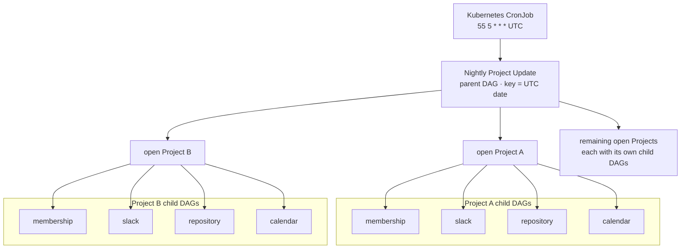
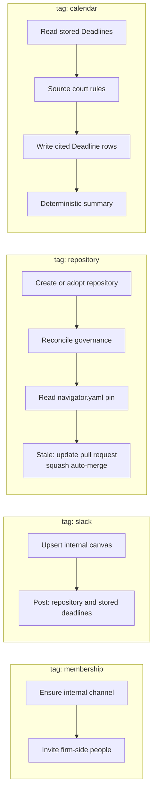

The daily routine cleanup of every [Project](project.md) in a [Deployment Environment](deployment-environment.md).
Kubernetes owns the clock. [Restate](restate.md) owns the journal. One parent [Workflow](workflow.md) fans out to a
closed set of **tagged child DAGs**. Each tag is itself a DAG — a Nightly Project Update is a DAG of DAGs, not a single
membership pass with extra steps bolted on.

The parent, `NightlyProjectUpdate`, is a Restate workflow keyed on the UTC date, so a second fire on the same day
attaches to the first. It journals the clock and the Project roster, then runs one child workflow per (Project, tag),
keyed `{date}:{project id}`. The `membership`, `slack`, and `repository` children are implemented as
`NightlyProjectUpdateMembership`, `NightlyProjectUpdateSlack`, and `NightlyProjectUpdateRepository`. The `calendar`
child is not yet implemented. The CronJob `nightly-project-update-trigger` runs at **05:55 UTC daily**, using `timeZone:
Etc/UTC`; it does not follow Pacific daylight saving time. Parent and children:
[`nightly_project_update.rs`](../../workflows-service/src/nightly_project_update.rs).

The diagrams show the full composition. Each open Project gets its own set of child DAGs.

A closed or archived Project is not updated. It gets no new channel, invitation, canvas, notice, or repository, and
`membership` archives its recorded internal channel instead. The parent counts a failure per Project and tag and
continues the other children. Directory emails and Slack identities stay inside the journaled operation; the environment
report (`#messages` or `#staging-messages`) carries aggregate counts only.

## Tags

The tag set is closed. Adding a tag is a glossary change in the same PR as the child DAG. The following responsibilities
describe the children, including work not yet implemented.

`membership` — create or adopt the **internal** Slack channel (`project-<code>`, or `staging-<code>` on a simulated
deployment). Invite the Lawyer [DRI](directly-responsible-individual-dri.md), participating Clerks, and owning-Firm
Lawyers and Clerks. Prefer recorded Slack identities. Never invite a client. Never write the customer Slack channel.

`slack` — upsert the internal channel's one canvas: synopsis, Client DRI emails, Lawyer DRIs, portal
`/app/projects/{code}/portal/`, and basic handles (code, status, repository URL when recorded). A later run edits the
same canvas. Post a daily notice with the recorded repository's latest default-branch commit date and a commits link,
plus up to 20 open stored Deadlines, quoting `due_at`, calendar role, and authority. A missing or unavailable forge is
reported in the notice. Canvas failure does not suppress the notice. Repository and deadline content stays inside the
journaled step; its result carries counts only. Never read or write the customer channel.

`repository` — create or adopt the private repository and record its URL. Read `navigator.yaml` `version:` against the
running Navigator release. On GitHub a stale pin is only reported. On Forgejo (`NAVIGATOR_FORGE_BACKEND=forgejo`) the
tag uses the Project's own Firm client. Once the repository has a head commit, it reconciles the [Repository
Governance](repository-governance.md) every night. For a stale pin, it opens one pull request per release on
`navigator/update-<release>`, rewriting only `version:`, with squash auto-merge waiting for the gate. A re-run reuses
the open pull request, and a closed one is not reopened. Nothing is pushed to `main`. The report counts update pull
requests opened, awaiting merge, and declined, and the repositories whose governance was repaired. Participation is
never copied onto the forge.

`calendar` — read stored [Deadlines](deadline.md), keep Project-set `internal` dates, source the applicable court rules
(private Notion page, then approved research MCPs), and write cited Deadline rows. The summary quotes stored `due_on`
and citations. Dates are never invented at read time.

The customer Slack channel (`project.external_slack_channel_url`) is a different handle. No tag writes it.

- Clock: [`docs/cronjobs.md`](../cronjobs.md)
- Journal: [`docs/durable-workflows.md`](../durable-workflows.md)
- Membership child:
  [`membership.rs`](../../workflows-service/src/nightly_project_update/membership.rs)
