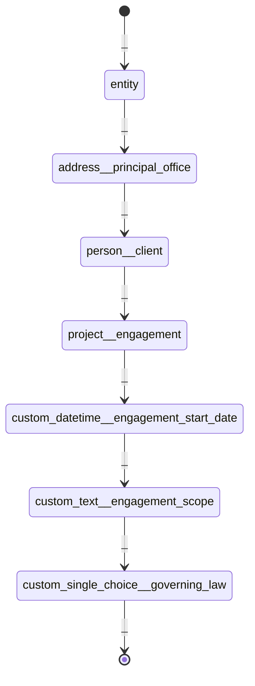
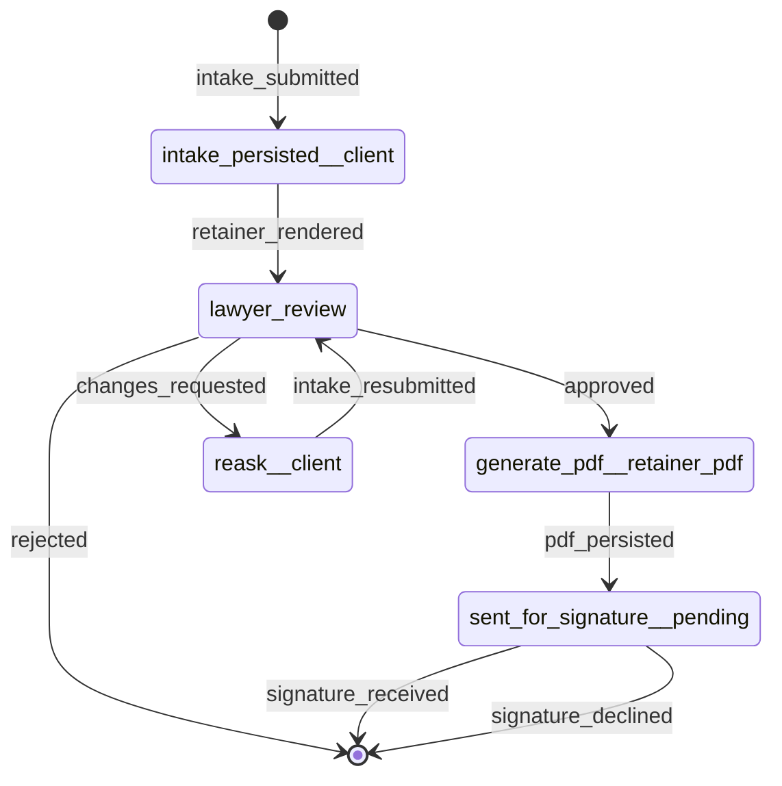

# Retainer intake walkthrough

The retainer-intake flow is a pair of durable state machines per [Notation](notation.md#notation), declared in the
frontmatter of the [shared onboarding letter](../templates/notations/neon_law/onboarding__letter.md) and walked by the
[`portal::retainer_walk`](../portal/src/retainer_walk.rs) module:

1. **Questionnaire walker** — one question per request, one [Answer](notation.md#answer) per advance, one
   [Notation Event](glossary/notation-event.md) per transition. Walks the state chain `BEGIN` → `entity` →
   `address__principal_office` → `person__client` → `project__engagement` → `custom_datetime__engagement_start_date` →
   `custom_text__engagement_scope` → `custom_single_choice__governing_law` → `END` — seven questions in all. The
   matter's scope renders from the clause spliced at `{{custom_clauses}}`, written per client; fees are set in a
   separate signed fee writing rather than asked here.
2. **Post-intake workflow** — fires once the questionnaire reaches `END`. Walks `intake_persisted__client` →
   `lawyer_review` → `generate_pdf__retainer_pdf` → `sent_for_signature__pending` → `END`, driving render, PDF
   persistence, and "sent for signature".

Both timelines use [StateMachineRuntime](../workflows/src/runtime.rs), keyed by `(MachineKind, notation_id)`. The web
deployment hosts the DBOS executor and stores each machine's transitions in PostgreSQL.

## Questionnaire state machine



The bare `_` condition is the only signal that advances a questionnaire (the canonical "respondent answered"). State
names use the typed `<type>__<role>` grammar, so the retainer asks for an Entity, an Address, a Person, and a Project
instead of duplicating their fields as custom text. `entity` carries no role suffix because the questionnaire asks for
only one entity — the Client itself.

## Post-intake workflow



State names use the `<prefix>__<discriminator>` form so [`workflows::step_kind_for`](../workflows/src/step.rs) can pick
the right actor class (system / lawyer / respondent) per state.

## HTTP surface

Four routes, all under [`portal::retainer_walk`](../portal/src/retainer_walk.rs):

- `GET /app/lawyer/retainers/new` — render the "start a walk" form.
- `POST /app/lawyer/retainers/new` — find-or-insert person, then immediately commit project + role + notation;
  redirect to `/app/lawyer/notations/:id/step`.
- `GET /app/lawyer/notations/:id/step` — render the current question, or redirect once the questionnaire reaches
  `END`.
- `POST /app/lawyer/notations/:id/step` — persist the answer, signal the runtime, advance the walker — or, on
  `END`, drive the post-intake workflow (render → send for signature).

### The client-initiated start

The client-initiated start opens a new `pitch` matter from a mapped service card, adds the signed-in client and the
configured lawyer DRI, and sends the client to the questionnaire. Admission is the ordinary cookie session and the
client participation row, with no magic-link credential or second identity scheme. A deployment must set the
`NAVIGATOR_ON_CALL_LAWYER_EMAIL` to an admitted lawyer-tier Person before the door will open. The door does not quote a
fee, file anything, or bypass the conflict check and lawyer-review gate.

Every state-changing request carries a CSRF token; auth is enforced by the `require_auth` layer on the admin router.

## One POST through the stack

The walker writes [Answers](notation.md#answer). DBOS serializes transitions for each machine and the PostgreSQL
transaction records one [Notation Event](glossary/notation-event.md) per transition. Reads use the latest event for the
Notation and machine kind.

Answers themselves are stored in the `answers` table, keyed by `(question_id, person_id)`. The walker pre-fills the
prior answer when the user navigates back so re-display is read-only.

## Durable execution

Native Notation execution uses the PostgreSQL-backed DBOS worker in
[`workflows-service/src/dbos_notation.rs`](../workflows-service/src/dbos_notation.rs). It serializes each Notation's
transitions and persists state and Notation Events through the existing transactional store seams. The application uses
[`DbosNotationRuntime`](../workflows/src/runtime_dbos.rs) with its explicit ingress and bearer token.

## The signature seam

[`portal::signature::SignatureProvider`](../portal/src/signature.rs) is an async trait with three methods:

```rust
#[async_trait]
pub trait SignatureProvider: Send + Sync {
    async fn send_for_signature(
        &self,
        notation_id: Uuid,
        pdf: &[u8],
        manifest: &SignatureManifest,
    ) -> Result<SignatureRequestId, SignatureError>;

    async fn create_recipient_view(
        &self,
        request_id: &SignatureRequestId,
        view: &RecipientView,
    ) -> Result<String, SignatureError>;

    async fn fetch_completed_documents(
        &self,
        request_id: &SignatureRequestId,
    ) -> Result<CompletedDocuments, SignatureError>;
}
```

`FakeSignatureProvider` records every call to an internal `Mutex<Vec<…>>`; tests assert on it, and it is what a boot
runs when `NAVIGATOR_SIGNATURE_PROVIDER=fake` — the explicit local signature loop. `DocuSignSignatureProvider`
([`portal/src/signature.rs`](../portal/src/signature.rs)) is already a live, shipped implementation of the same trait —
[`portal::hosting`](../portal/src/hosting.rs) selects between them through the one environment value
`NAVIGATOR_SIGNATURE_PROVIDER`, which accepts only `fake` or `docusign` and refuses to boot otherwise. Both use the same
`Arc<dyn SignatureProvider>` in [`portal::AppState`](../portal/src/lib.rs), consistent with
[`docs/provider-environment-parity.md`](provider-environment-parity.md)'s description of DocuSign as live per-deployment
infrastructure rather than a future swap-in.

## Test coverage

- **Spec shape**: [`workflows/tests/retainer_intake_spec.rs`](../workflows/tests/retainer_intake_spec.rs) parses the
  YAML and drives the spec end-to-end on `InMemoryRuntime`.
- **Walker progress**: unit tests in [`portal/src/retainer_walk.rs`](../portal/src/retainer_walk.rs) cover
  `progress_for` across BEGIN, mid-walk, and the last-question cap.
- **View components**: SSR tests beside each Dioxus page cover the four lawyer renders:
  [`webapp/src/retainer_start.rs`](../webapp/src/retainer_start.rs) the template picker and its refusal flash,
  [`webapp/src/walker_step.rs`](../webapp/src/walker_step.rs) the per-answer-type step (text / country / people-list
  branches, prior-answer pre-fill), [`webapp/src/intake_review.rs`](../webapp/src/intake_review.rs) the review phases
  and the CSRF token on every write, and [`webapp/src/reask.rs`](../webapp/src/reask.rs) the flagged re-ask.
- **Notation HTTP transport**: [`workflows/src/notation_http.rs`](../workflows/src/notation_http.rs) uses `wiremock`
  to pin wire shape, authentication, trace propagation and failures per `MachineKind`. Adapter tests retain legacy
  service selection and native revision-bound approval checks.
- **Worker handlers** run transitions in [`dbos_notation.rs`](../workflows-service/src/dbos_notation.rs) and append
  events through [`journal.rs`](../workflows-service/src/journal.rs).
- **HTTP + browser**: `server/tests/browser_e2e.rs` drives the full retainer walk end-to-end via fantoccini +
  chromedriver.
