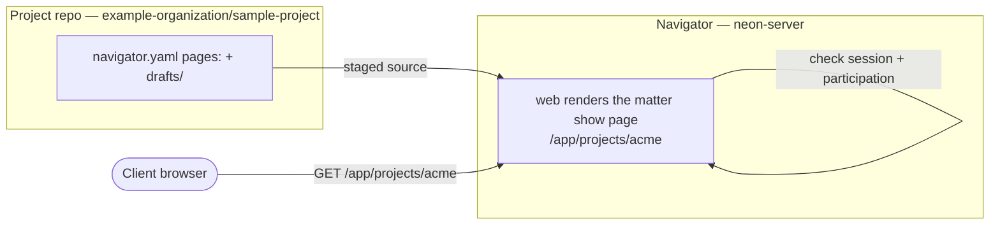
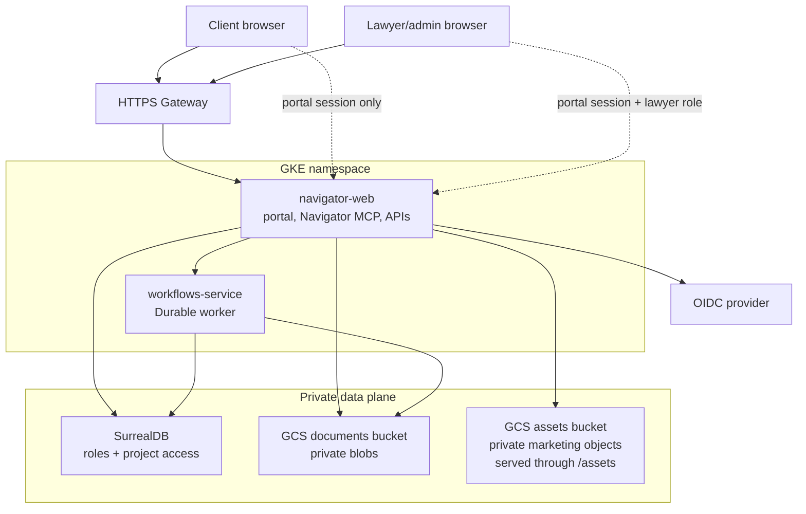

# Operating Neon Law Navigator

Our firm runs Neon Law Navigator on Google Cloud. This workshop is for **admin** users with a clone of the public source
repository, [neon-law/navigator](https://github.com/neon-law/navigator): the people who own billing, secrets, OIDC,
runtime configuration, and release verification. It stands up your **own** instance — the same Rust stack our attorneys
use, on your own Google Cloud project, for your own community.

One command does most of the work: `navigator ops gcp setup`, a provisioner written in Rust that talks to Google's REST
APIs directly and ships with a dry-run so you can read the whole plan before a single packet leaves your laptop.

Two things to hold up front. This provisions **billable** Google Cloud resources — a GKE Autopilot cluster and six core
storage buckets, with optional archive and telemetry lanes — so it is not free, and you should set a budget alert before
you begin. This is a deployment guide for admin users standing up infrastructure. With that said: you can run the same
stack we run. Let's stand it up.

> **Bring your own typeface license.** Neon Law Navigator source code is owned by Neon Law IP LLC.
> [GORP Serif](https://trashtype.com/fonts/gorp) is proprietary font software licensed separately from TrashType and is
> not covered by the repository's code licenses.
> If your deployment serves GORP, obtain and maintain the appropriate TrashType license, keep its license notice with
> your font files, and follow the [TrashType terms](https://trashtype.com/legal).
> Otherwise, replace GORP with a typeface you are licensed to serve before launch.
>
> **Start locally with an authorized checkout.** You do not need a cloud account to see Neon Law Navigator run.
> `cargo run -p cli -- dev up` brings the whole stack up locally in
> [KIND](https://kind.sigs.k8s.io/) (the store, OIDC, storage, the workflow broker, embedded Rego), then
> `source .devx/env` and
> `cargo run -p neon` serves it on `localhost`. Boot it locally, inspect the canonical seed, and only
> come back here when you want it on the public internet. The full local loop is in the checkout's `AGENTS.md`.

**Set the budget alert before you provision** — one command caps the surprise so the bill cannot run away while you
learn:

```bash
gcloud billing budgets create --billing-account "$BILLING_ACCOUNT_ID" \
  --display-name "Neon Law Navigator" --budget-amount 200USD \
  --threshold-rule percent=0.5 --threshold-rule percent=0.9
```

Idle, the stack runs on the order of an Autopilot cluster's baseline plus six mostly empty buckets — budget for it,
watch the first invoice, and size the cluster down if it is more than you need.

## Intro

### Deploy your own

Follow this workshop to stand up your own Neon Law Navigator. `navigator ops gcp setup` stands the same Rust stack our
attorneys run up on your Google Cloud project. Free, open, and yours to keep.

---

The rest of this workshop is the self-serve install, end to end. Everything from here down stands up a working instance
you own outright.

### Agenda

Six steps, each tagged with its Bloom verb. You are the admin operator; the `navigator` CLI is the instrument:

- **Create** — stand up a billed project and authenticate.
- **Predict** — run `--dry-run` and read every API call before sending one.
- **Identify** — name the twenty-three Google Cloud APIs the provisioner enables.
- **Explain** — describe the VPC, six core buckets, optional archive/telemetry lanes, private image registry, and
  configured service deployments.
- **Execute** — bring up the cluster, the static IP, and Fleet membership.
- **Verify** — ship the service images and confirm `/readyz` answers 200.

---

Each step is tagged with the Bloom verb it exercises (the [Anderson & Krathwohl 2001
revision](https://en.wikipedia.org/wiki/Bloom%27s_taxonomy)). You are the admin operator; the `navigator` CLI is the
instrument. **Create** — stand up a billed Google Cloud project and authenticate so `navigator` can act on your behalf.
**Predict** — run `navigator ops gcp setup --dry-run` and read every API call the provisioner _would_ make before
sending one. **Identify** — name the twenty-three Google Cloud APIs the provisioner enables, and why each is needed.
**Explain** — describe the VPC, the six core storage buckets and optional archive/telemetry lanes, the private image
registry, the configured service deployments, and why re-running setup is always safe. **Execute** — bring up the GKE
Autopilot cluster, the static IP, and Fleet membership with one command. **Verify** — ship the images and confirm the
running service answers `/readyz` with a 200.

## Prepare Google Cloud

### Bring your own project

`navigator ops gcp setup` provisions _into_ a project; it does not create one. Start by creating a project and attaching
a billing account, then authenticate so the CLI can act as you:

```bash
gcloud projects create your-project-id --name "Neon Law Navigator"
gcloud billing projects link your-project-id --billing-account "$BILLING_ACCOUNT_ID"
gcloud auth login --force --update-adc
gcloud auth print-access-token >/dev/null
gcloud auth application-default print-access-token >/dev/null
```

Before provisioning, confirm billing is enabled for every selected project. Load each row from the operator-managed
root; check a separate registry project too when your installation uses one:

```bash
for CONFIG in "$NAVIGATOR_DEPLOYMENTS_DIR"/deployments/*/config.toml; do
  set -a; eval "$(grep ' = "' "$CONFIG" | sed 's/ = /=/')"; set +a
  gcloud billing projects describe "$NAVIGATOR_GCP_PROJECT_ID" \
    --format='value(projectId,billingEnabled)'
done
```

Each selected runtime project must show `True`. If a row is `False`, attach billing before running setup. Check a
registry project by supplying its operator-managed ID:

```bash
gcloud billing projects describe "$NAVIGATOR_IMAGE_REGISTRY_PROJECT" \
  --format='value(projectId,billingEnabled)'
```

---

The [project creation guide](https://cloud.google.com/resource-manager/docs/creating-managing-projects) walks both the
create and the billing link. The provisioner uses both the active `gcloud` credential for shell-outs and [Application
Default Credentials](https://cloud.google.com/docs/authentication/provide-credentials-adc) for its REST client.
`--update-adc` refreshes both in one browser flow. Google Workspace session controls can expire both credentials; rerun
the three authentication lines before resuming when either token probe fails.

You also need `gcloud`, `kubectl`, and `docker` on your `PATH`: the cluster steps shell out to `gcloud`, the image ships
with `docker`, and you reconcile manifests with `kubectl`. Nothing in this workshop hard-codes our project name, region,
or cluster — every value flows through a flag or an environment variable, because this guide documents the deploy path
for you to point at your own cloud.

### Dry-run first

Before you change anything, read the plan. The `--dry-run` flag records every REST call and `gcloud` shell-out and
prints them without sending traffic:

```bash
cargo run -p cli -- ops gcp setup --project-id your-project-id --dry-run
```

---

`gcloud` has no universal dry-run equivalent, so we built one — it prints the plan without sending traffic or touching
your `gcloud` session. You will see the plan in order: REST calls that enable APIs, create the VPC and subnet, create a
regional Cloud Router and Cloud NAT, and create six buckets. It then creates a deployment-specific Google service
account and its direct Secret Manager, bucket, and signed-URL permissions. A single-project install can also provision
its private Artifact Registry; an installation with a shared registry supplies that registry's project in its operator
configuration. The last stages grant registry access, reserve the gateway IP and create the cluster, then attach
Kubernetes Workload Identity and the cluster integrations. Read the project, region, and every resource prefix, then
drop `--dry-run` to execute. Every step is idempotent, so a re-run after a partial failure never produces duplicates.

The CLI waits for each control-plane write at that API's own operation endpoint before starting its dependent step.
Compute VPC operations are global; subnet, Router, and NAT operations are regional. Their REST resources report
completion with a `DONE` status. Service Usage and Artifact Registry use Google long-running operations and report a
true `done` flag. A newly enabled Compute API can still return `SERVICE_DISABLED` for a short propagation window after
its Service Usage operation completes. The VPC step recognizes only that exact `compute.googleapis.com` response, prints
the bounded retry count, and retries the idempotent insert for up to two minutes. Other `403` responses fail immediately
because they may be real IAM or organization-policy problems. If a terminal or network interruption stops setup after
GCP accepted a write, run the exact same deployment command again. Existing resources return idempotent conflicts. The
pipeline generates no credential of its own, so a run — first or tenth — prints no secret for you to record. The store
is SurrealDB, and its endpoint and root credentials come from your store provider.

Live setup prints nineteen secret-free stages, including the project and exact resource name:

```text
gcp setup [ROW] 01/19 enable required APIs
gcp setup [ROW] 04/19 Cloud Router and NAT setup
gcp setup [ROW] 05/19 create private assets bucket
gcp setup [ROW] 09/19 create private applications bucket
gcp setup [ROW] 12/19 configure runtime identities and IAM bindings
gcp setup [ROW] 13/19 configure container registry access
gcp setup [ROW] 14/19 create GKE Autopilot cluster
gcp setup [ROW] 15/19 configure workload identity and cluster integrations
gcp setup [example-project] 16/19 KMS key provisioned from the selected row
gcp setup [ROW] 17/19 log retention on the logs bucket and Cloud Logging _Default
gcp setup [ROW] 18/19 release ship identity (not configured; skipped)
gcp setup [ROW] 19/19 navigator-postgres-backup-target ConfigMap in navigator
gcp setup [ROW] COMPLETE
```

Stage 18 runs only when `--ship-deployment`, `--ship-repository`, and `--ship-environment` name the row, repository, and
GitHub Environment the release workflow ships from; see `docs/release-automation.md`.

Long-running REST writes print the service, operation ID, scoped polling path, and `DONE`. Output never includes the
store URL, access token, service-account key, or any other secret value, and the pipeline generates no credential that
would need printing.

On a newly activated project, one of these additional lines can appear between stages 1 and 2, depending on whether the
activation window meets the VPC insert or its operation poll:

```text
gcp api [compute.googleapis.com] activation is still propagating; retrying network setup (1/25)
gcp operation [Compute] operation-123: compute.googleapis.com activation is still propagating; retrying poll
```

### Private assets and domain restricted sharing

Every deployment bucket remains private. `navigator ops gcp setup` grants the deployment Google service account
`roles/storage.objectAdmin` on its assets, documents, exports, logs, and applications buckets, then maps both Kubernetes
service accounts (`navigator-web` and `workflows-service`) to that Google identity through Workload Identity. The
PostgreSQL backups bucket is the exception: only the `navigator-postgres-backup` Kubernetes service account gets object
admin on it, and the web identity gets nothing. It never adds `allUsers` and never changes
`constraints/iam.allowedPolicyMemberDomains`. The applications bucket is still provisioned, but nothing reads it: the
Portal is retired, and `/app/projects/{code}/portal` redirects to the matter show page.

The public website receives only marketing bytes through `GET /assets/*`. `web` reads that object from
`NAVIGATOR_ASSETS_BUCKET` with the deployment identity and returns it with its stored content type,
`X-Content-Type-Options: nosniff`, and a one-hour public cache. Unsafe keys and missing objects return `404`; storage
failures return `502`. There is no parallel anonymous route for documents, exports, or logs. This is an application
delivery boundary, not a Navigator `persons.role` or Project-participation grant.

Set `NAVIGATOR_ASSET_BASE_URL=$NAV_BASE_URL/assets` in each deployment's `config.toml` — it is a plaintext coordinate
the `ops ship` preflight requires. Setup also gives the active `gcloud` identity the same bucket-scoped object CRUD role
so the operator and the Kubernetes runtime can inspect and repair objects without a public or project-wide grant.

Publish the public asset inventory before `ops ship`. A full or image-only roll reads `NAVIGATOR_ASSETS_BUCKET` and
stops before any rollout when a required object is missing or the bucket cannot be read. The preflight and the post-roll
check use one inventory. On a source checkout that inventory is every markdown image under `server/content`, every
responsive gallery variant, the brand media keys, and every licensed webfont face. On a deploy-only checkout
(`--deployments-dir` with no `server/content` directory) blog references are absent, and the inventory is the workshop
images embedded in the CLI plus those same gallery variants, brand media keys, and fonts. Restart-only skips both
checks.

```bash
navigator ops assets build --src /path/to/source-jpegs
navigator ops assets upload
navigator ops assets fonts upload --family eb-garamond --dir /path/to/woff2
navigator site asset upload --host "$NAVIGATOR_PUBLIC_HOST" "$ASSET_PATH"
```

`assets build` then `assets upload` publishes the gallery variants. `assets fonts upload` publishes one licensed family.
`site asset upload` publishes one finished image, including brand media and a workshop slide. Run the publish that
covers the inventory, then `ops ship`.

After setup, verify both identities and reject an anonymous principal:

```bash
runtime_gsa="$NAVIGATOR_GCP_SERVICE_ACCOUNT_ID@$NAVIGATOR_GCP_PROJECT_ID.iam.gserviceaccount.com"
operator_account="$(gcloud config get-value account)"
case "$operator_account" in
  *.gserviceaccount.com) operator_member="serviceAccount:$operator_account" ;;
  *) operator_member="user:$operator_account" ;;
esac

for bucket_name in \
  "$NAVIGATOR_ASSETS_BUCKET" \
  "$NAVIGATOR_DOCUMENTS_BUCKET" \
  "$NAVIGATOR_EXPORTS_BUCKET" \
  "$NAVIGATOR_LOGS_BUCKET"
do
  iam_rows="$(
    gcloud storage buckets get-iam-policy "gs://$bucket_name" \
      --flatten='bindings[].members[]' \
      --format='value(bindings.role,bindings.members)'
  )"
  printf '%s\n' "$iam_rows" |
    awk -v runtime="serviceAccount:$runtime_gsa" -v operator="$operator_member" '
      $1 == "roles/storage.objectAdmin" && $2 == runtime { runtime_ok = 1 }
      $1 == "roles/storage.objectAdmin" && $2 == operator { operator_ok = 1 }
      $2 == "allUsers" { public = 1 }
      END { if (!runtime_ok || !operator_ok || public) exit 1 }
    '
done
```

---

No output and a zero exit status prove that both principals have `roles/storage.objectAdmin` and `allUsers` is absent.
The dogfood driver adds the active operator binding when it is absent; the Rust provisioner owns the runtime binding.

---

Pause on the trust boundary: the organization policy correctly rejects `allUsers`, so Navigator never solves asset
delivery by making a bucket public. Walk the verification output for both named principals, then contrast the one public
`/assets/*` application route with the absence of anonymous document, export, or log routes. The important result is
private object CRUD for the operator and workload identity, not a project-wide storage role.

---

The certificates are the part worth dwelling on. A classic Google-managed certificate is validated by a CA *calling the
load balancer*, so DNS has to point there first — moving a live hostname takes it down for the length of issuance, and
Cloud CDN and the HTTP-to-HTTPS redirect both sit in the validation path. Certificate Manager with a **DNS
authorization** avoids that: Google returns a `CNAME`, the CA reads that record, and the certificate reaches `ACTIVE`
while the hostname still serves its current site. Publish the `CNAME` first, wait for `ACTIVE`, then move the `A` record
— a cutover done that way carries no TLS gap. The GKE ingress here owns its own certificates, so it is the classic path
above rather than this one.

---

Name a hostname collision before a cutover. A hostname, certificate, and authorized OAuth redirect URI must belong to
one deployment at a time. When moving a hostname, stage its new certificate and routing configuration before changing
DNS, and retire the prior route only after the new endpoint is verified.

### The Navigator deployment matrix

Each deployment has one `config.toml` and one encrypted `secrets.enc.yaml` under the operator-managed deployment root:
`$NAVIGATOR_DEPLOYMENTS_DIR/deployments/<row>/`. The config supplies that row's project, region, cluster, namespace,
host, and image settings. Keep each row's database, buckets, Kubernetes namespace, runtime identity, and Secret isolated
from other rows. The private root is supplied by the operator and is not part of this source repository.

---

The runtime topology is defined by the operator's rows. A staging row can exercise sample matters through the same
shared application, data-access, authorization, API, and agent-protocol code used by production brands. An image
registry project is a separate publishing resource, not an application environment.

---

Read the deployment matrix from the private operator configuration. A row's hostname is configuration, not code —
`NAVIGATOR_PUBLIC_HOST` in its `config.toml` — so the public URL can change without renaming a crate, image, or
deployment. Keep each production brand's resource prefix, database, cluster, namespace, runtime identity, Secret, and
Restate journal isolated. Staging proves the common application; brand route tests prove the public face shipped by each
immutable image.

### The `/app` mount and HTTP route ownership

`/app` is the container filesystem mount, not a public URL prefix. The images install their executable and common
runtime material there:

| Image | Entrypoint | Shared mounted material |
| --- | --- | --- |
| `neon-server` | `/app/neon` | `/app/public`, `/app/content`, `/app/templates` |

Each executable supplies only its public brand routes to `portal::bootstrap`. The mounted application crate always owns
these HTTP paths and every descendant:

- operational and public ingress: `/version`, `/assets/*`, `/webhook/*`, `/docusign/*`, `/public/*`, and
  `/dioxus-demo`;
- application and control surfaces: `/app/*`, `/app/api/*`, `/app/health`, `/app/readyz`, `/app/mcp/*`, `/auth/*`,
  and `/docs/*`;
- API documentation: `/app/api` and `/app/api/openapi.json`.

The brand-owned public routes are:

- Neon Law: `/`, `/contact`, `/team`, `/team/nick`, `/blog`, `/blog/{slug}`, `/notations`, `/workshops/*`,
  `/presentations/*`, `/privacy`, `/terms`, `/robots.txt`, `/sitemap.xml`, and `/llms.txt`.

This precedence is fail-closed, not merge order. Each brand declares every route it mounts; startup returns an error if
an exact path or descendant overlaps a Navigator-owned prefix. A brand therefore cannot shadow data access,
authorization, control, API, health, or protocol routes.

---

Keep the two mount concepts separate while presenting: `/app` is the shared container filesystem root, while the HTTP
router mounts a brand's bounded public face around the Navigator-owned application and control surfaces. The declared
path inventory makes that boundary executable at startup.

### `neon` — the whole brand seam

A brand crate is exactly one value: the `portal::hosting::Brand` each compiles — its key, its telemetry service name,
and the bounded public routes listed on the previous slide. Everything else is the shared application they mount, and
the portal renders under the mounting brand's chrome, so branding the binary brands the portal too: one brand seam
carries the public site, the signed-in portal, and the telemetry identity together.

That thinness is the customization story. A custom Navigator changes minimal surface area: write your own brand crate in
the `neon` shape — a `Brand` value and a call to the shared run loop, nothing more — build it into your own
`<brand>-server` image, and interact with the remaining published images (`navigator-workflows-service`, the trigger
images) unchanged. The two brand Containerfiles are deliberately identical modulo the brand name, so the image recipe
for a new brand is the existing one with your crate's name.

---

Two tests keep this slide honest: the thin-crate rule fails any brand crate that reaches past `portal`, `views`, and
`telemetry` into the domain crates, and the brand-image parity test fails a Containerfile edit applied to one brand
recipe and not the other. To rebrand a _deployment_ without writing a crate at all, use the white-label brand bundle
covered later in this workshop.

### Live rollout checkpoint

The rollout checkpoint is the repository's deployment contract:

Six unconditional private buckets — assets, documents, exports, logs, PostgreSQL backups, and applications — plus
optional archive and telemetry lanes when named. Project growth adds rows and logical key space; it never creates a
cloud bucket per Project. The retired Portal's objects remain under a `{project-code}/portal/` prefix in the
applications bucket until an operator deletes them by hand. The documents bucket stores Project-scoped content-addressed
`projects/<code>/documents/<sha>` objects, while Surreal asset rows carry the Project association, visibility, and
provenance used for authorization. Marketing bytes remain available through the same-origin `/assets/*` application
route while the bucket itself stays private and does not grant `allUsers`.

New clusters are created with `--enable-fleet`; the subsequent idempotent reconciliation can therefore report `Changing
existing fleet membership is not supported`. Navigator treats only that exact response as already reconciled and
continues; unrelated Fleet errors still stop setup.

Infrastructure is not deployment. A completed setup provisions infrastructure but not a running application. Ship an
immutable release and prove `/readyz`, `/version`, certificate readiness, Restate registration, and the browser surface
before recording the release handoff.

For a prefix `<name>`, set `NAVIGATOR_GKE_CLUSTER_NAME=<name>`, `NAVIGATOR_GKE_CONTEXT=gke_<project>_<region>_<name>`,
`NAVIGATOR_K8S_NAMESPACE=<name>`, `NAVIGATOR_VPC_NAME=<name>-vpc`, `NAVIGATOR_SUBNETWORK_NAME=<name>-subnet`,
`NAVIGATOR_GATEWAY_IP_NAME=<name>-gateway-ip`, `NAVIGATOR_ASSETS_BUCKET=<name>-assets`,
`NAVIGATOR_DOCUMENTS_BUCKET=<name>-documents`, `NAVIGATOR_EXPORTS_BUCKET=<name>-exports`,
`NAVIGATOR_LOGS_BUCKET=<name>-logs`, `NAVIGATOR_APPLICATIONS_BUCKET=<name>-applications`,
`NAVIGATOR_GCP_SERVICE_ACCOUNT_ID=<name>-web`, `NAVIGATOR_DRIVE_GCP_SERVICE_ACCOUNT_ID=<name>-drive`, and
`NAVIGATOR_WEB_SECRET_NAME=<name>-web-secrets`. Bucket names are global; choose an available name under your
organization's naming convention.

Also set `NAVIGATOR_GCP_PROJECT_ID`, `NAVIGATOR_GCP_LOCATION`, `NAVIGATOR_PUBLIC_HOST`, `NAVIGATOR_WORKFLOWS_HOST`,
`NAV_BASE_URL=https://$NAVIGATOR_PUBLIC_HOST`, `NAVIGATOR_WORKFLOWS_URL=https://$NAVIGATOR_WORKFLOWS_HOST/`,
`NAVIGATOR_WEB_IMAGE`, and `NAVIGATOR_ASSET_BASE_URL=$NAV_BASE_URL/assets` in that row's
`$NAVIGATOR_DEPLOYMENTS_DIR/deployments/<row>/config.toml`. Set that row's own `NAVIGATOR_SURREAL_*` coordinates and
credentials in its encrypted `secrets.enc.yaml`.

Keep the mail rail complete in every deployment's encrypted `secrets.enc.yaml`: `SENDGRID_API_KEY`,
`SENDGRID_FROM_EMAIL`, `SENDGRID_INBOUND_SECRET`, `SENDGRID_INBOUND_PUBLIC_KEY`, `SENDGRID_EVENTS_SECRET`, and
`SENDGRID_EVENTS_PUBLIC_KEY`. Use credentials appropriate to that row's environment and host.

Provision each row with the same region-agnostic command — one run per private deployment row, with its coordinates
exported from that row's `config.toml`. Set the variables below from the operator-managed root; the example does not
create, decrypt, or provision private rows. Each run creates six core buckets and one Autopilot cluster; configured
archive and telemetry lanes are additional:

```bash
: "${NAVIGATOR_DEPLOYMENTS_DIR:?set this to the operator-managed private deployment root}"
ROW="${ROW:?set this to the selected row name}"
CONFIG="$NAVIGATOR_DEPLOYMENTS_DIR/deployments/$ROW/config.toml"
set -a; eval "$(grep ' = "' "$CONFIG" | sed 's/ = /=/')"; set +a
navigator ops gcp setup --dry-run
```

Check every printed project, region, resource prefix, and the two API batches. Provision the registry hub once before
the runtime stacks; it runs no workloads:

```bash
navigator ops gcp hub setup \
  --project-id "$NAVIGATOR_IMAGE_REGISTRY_PROJECT" --region "$NAVIGATOR_GCP_LOCATION" --dry-run
navigator ops gcp hub setup \
  --project-id "$NAVIGATOR_IMAGE_REGISTRY_PROJECT" --region "$NAVIGATOR_GCP_LOCATION"
```

Then apply the already-reviewed plans one deployment at a time. Keep staging first, and do not begin production until
its command finishes:

```bash
set -a; eval "$(grep ' = "' "$CONFIG" | sed 's/ = /=/')"; set +a
navigator ops gcp setup
```

That is the live resource boundary, per deployment: six core buckets, plus any named archive/telemetry lanes, one
VPC/subnet pair, one reserved gateway address, one Autopilot cluster, one KMS key, and two deployment service accounts.
The command also enables the twenty-three required APIs in that runtime project. A completed command is not yet a
deployed website; `ops ship`, DNS, and the browser checks later in this workshop remain required.

Setup provisions no database and generates no credential, so there is nothing printed to record. The store's own
credentials go into `$NAVIGATOR_DEPLOYMENTS_DIR/deployments/<row>/secrets.enc.yaml` (`sops set` — the plaintext never
touches disk), then `navigator ops secrets apply --deployment "$ROW" --deployments-dir "$NAVIGATOR_DEPLOYMENTS_DIR"`;
rotation happens at the provider first, per [`docs/deployment-secrets.md`](/docs/deployment-secrets).

Resolve every reserved address and record the public value as `NAVIGATOR_GATEWAY_IP` in the matching private
`config.toml`. Keep this public infrastructure coordinate in the operator-managed deployment root:

```bash
for CONFIG in "$NAVIGATOR_DEPLOYMENTS_DIR"/deployments/*/config.toml; do
  set -a; eval "$(grep ' = "' "$CONFIG" | sed 's/ = /=/')"; set +a
  echo "${CONFIG%/config.toml}:"
  gcloud compute addresses describe "$NAVIGATOR_GATEWAY_IP_NAME" \
    --global --project "$NAVIGATOR_GCP_PROJECT_ID" --format 'value(address)'
done
```

Populate the matching local Kubernetes context before shipping a row:

```bash
: "${ROW:?set this to the selected row name}"
CONFIG="$NAVIGATOR_DEPLOYMENTS_DIR/deployments/$ROW/config.toml"
set -a; eval "$(grep ' = "' "$CONFIG" | sed 's/ = /=/')"; set +a
gcloud container clusters get-credentials \
  "$NAVIGATOR_GKE_CLUSTER_NAME" --region "$NAVIGATOR_GCP_LOCATION" \
  --project "$NAVIGATOR_GCP_PROJECT_ID"
```

The resulting context name must equal that config's `NAVIGATOR_GKE_CONTEXT`. Repeat once for each deployment you are
operating.

The [canonical matrix](/docs/environments) is the compact reference for every row.

---

Pause on the isolation boundary: staging proves the shared mounted application, while the production data planes stay
isolated. Point to the resource prefix column and verify that every database, bucket set, cluster, namespace, service
account, Secret, and gateway address carries the row's prefix. Then demonstrate the dry run before discussing any
billable live command.

### Set one site to one version

The version is a release tag, never `latest`. To preview one site's local plan, name its deployment with the required
`--deployment` flag and replace `YY.M.D` with the published tag. This offline preview renders local manifests and does
not check cloud authentication, IAM, image availability, or live state. A real roll requires the signed image-digest map
and live preflight described in [`docs/manual-roll.md`](/docs/manual-roll).

```bash
: "${NAVIGATOR_DEPLOYMENTS_DIR:?set this to the operator-managed private deployment root}"
: "${ROW:?set this to the selected row name}"
: "${TAG:?set this to the published release tag}"
CONFIG="$NAVIGATOR_DEPLOYMENTS_DIR/deployments/$ROW/config.toml"
set -a; eval "$(grep ' = "' "$CONFIG" | sed 's/ = /=/')"; set +a
host="$NAVIGATOR_PUBLIC_HOST"
navigator ops ship --deployment "$ROW" --deployments-dir "$NAVIGATOR_DEPLOYMENTS_DIR" --tag "$TAG" --dry-run
# For a real roll, first prepare the signed map as described in docs/manual-roll.md.
navigator ops ship --deployment "$ROW" --deployments-dir "$NAVIGATOR_DEPLOYMENTS_DIR" --tag "$TAG" \
  --image-digests "$IMAGE_DIGESTS"
curl --fail --show-error "https://${host}/version"
```

For each configured row, load its private config and repeat the single-row command after the staging verification
passes. The release workflow obtains the rows from the configured external root and gates production on staging.

```bash
: "${NAVIGATOR_DEPLOYMENTS_DIR:?set this to the operator-managed private deployment root}"
: "${ROW:?set this to the selected row name}"
navigator ops ship --deployment "$ROW" --deployments-dir "$NAVIGATOR_DEPLOYMENTS_DIR" --tag "$TAG" \
  --image-digests "$IMAGE_DIGESTS"
```

Staging goes first. Do not start a configured production row until staging `/readyz` and `/version` checks pass. To
preview without changing one site, append `--dry-run`; to refresh its pods after a secret rotation without changing the
version, use `--restart-only`. A deployment can be named here only after its private configuration is provisioned under
`$NAVIGATOR_DEPLOYMENTS_DIR/deployments/<row>/`.

---

Demonstrate the single-deployment control surface with a configured staging row: `--deployment` selects the entire stack
and the release tag selects the version. An operator verifies `/readyz` and `/version` before moving to the next row; by
hand the command block is a sequence, not a request to roll every cluster concurrently. The release workflow rolls
configured production rows after a green staging roll.

Everything from here on provisions a real deployment.

## Provision the Infrastructure

### The APIs that light up

A real run first enables twenty-three Google Cloud APIs in bounded [Service
Usage](https://cloud.google.com/service-usage/docs/enable-disable) `batchEnable` calls: `compute`, `servicenetworking`,
`storage`, `iam`, `iamcredentials`, `sts`, `cloudresourcemanager`, `artifactregistry`, `container`, `gkehub`,
`gkebackup`, `anthosconfigmanagement`, `logging`, `monitoring`, `cloudtrace`, `secretmanager`, `certificatemanager`,
`identitytoolkit`, `speech`, `drive`, `admin`, `cloudkms`, and `aiplatform`.

---

`batchEnable` completes as a long-running operation. Enabling an already-enabled API is a no-op, so this step — like
every step — is safe to repeat. Service Usage accepts twenty services per request, so Navigator sends two bounded
batches. Nothing else in the run works until these are on, which is why it goes first. Google can briefly report the
Compute API as disabled at its own endpoint after the enable operation is done; the following VPC step waits through
that narrowly identified propagation case instead of making the operator restart the whole provisioning run.

### Network and storage buckets

With the APIs on, the CLI provisions the data plane and runtime identity:

- A **custom-mode VPC** with one explicitly named regional subnet and private Google access. The deployment's GKE
  cluster is pinned to both names.
- **Six private Cloud Storage buckets**, all uniform bucket-level access: `-assets` (marketing objects served through
  the same-origin `/assets/*` application route), `-documents` (client documents), `-exports` (Parquet/Iceberg
  archives), `-logs` (the Nearline log-sink destination), `-postgres-backups` (the PostgreSQL WAL archive and base
  backups, expired at 30 days), and `-applications` (still provisioned; the retired Portal's bundles are no longer read
  or written). A deployment may also name separate archive and telemetry buckets for long-term snapshots and telemetry
  landing data.
- A **deployment-specific Google service account** with the Secret Manager accessor role, object access on only that
  deployment's core buckets other than PostgreSQL backups and any named archive/telemetry lanes, Workload Identity
  bindings for the namespace's `navigator-web` and `workflows-service` Kubernetes service accounts, and permission to
  sign its own GCS URLs.
- A separate **Workspace Drive service account** with no runtime GCP roles. An operator creates one JSON key, records it
  in that deployment's `secrets.enc.yaml`, and grants its OAuth client domain-wide delegation in the selected Workspace.

---

No stage generates a credential, so a run prints no secret and there is nothing to record. The six core private
[buckets](https://cloud.google.com/storage/docs/creating-buckets) are: `your-project-id-assets` — marketing photography
read by `web` and delivered through `/assets/*`; `your-project-id-documents` — client documents, where `web` writes
content-addressed blobs, kept separate from assets; `your-project-id-exports` — nightly Parquet/Iceberg snapshots
written by `workflows-service`; `your-project-id-logs` — the Nearline destination for the deployment's Cloud Logging
sink; `your-project-id-postgres-backups` — the PostgreSQL WAL archive and daily base backups, read and written only by
the `navigator-postgres-backup` Kubernetes service account; and `your-project-id-applications` — still provisioned,
though the retired Portal no longer reads or writes it. Setup creates the logs bucket but not the operator-managed sink;
complete the per-deployment sink recipe in [`docs/gke-prod.md`](/docs/gke-prod). Clients do not get GCS IAM roles or
bucket URLs: they see documents through Navigator after it checks their session and Project participation row. Every
create call treats an HTTP **409 Conflict** as success — that is Google's "already exists" response — which is exactly
what makes re-running setup safe rather than destructive.

### How a matter's pages reach a client

Each Project has its own source repository — for example, `example-organization/sample-project` — holding
`navigator.yaml`, Markdown Drafts, and YAML. A matter's client-facing pages are its Matter Pages, declared under
`pages:` in `navigator.yaml` and rendered by `web` on the matter show page, `/app/projects/{code}`, after the session
and Project participation row are checked. No bundle is built, published, or streamed. `/app/projects/{code}/portal` and
every path beneath it answer `301` to the matter show page.



---

The **repository name is the Project code**, so the matter show page's path (`/app/projects/acme`) derives from it. The
per-Project `nav-pub-<code>` publisher service accounts and the `application-publish` action are retired with the
Portal; a Project's `cd.yml` still calls `project-publish.yml`, which is kept as a no-op so existing callers stay green.

### A document's bytes and authorization are separate

Inside the documents bucket, the storage key is content-addressed: `store::documents::ingest_bytes` writes bytes at
`blobs/<sha256>`. The Surreal `asset` row is the Project-scoped record: it carries the Project association, provenance,
visibility, and the reference to that object. The portal checks that row before streaming a document, so clients never
receive bucket credentials or direct object URLs.

The ingest deduplication decision is scoped to the Project, even though the key shape is not: an existing matching asset
on the same Project avoids a second write, while a matching asset on another Project does not authorize reuse of its
row. Because two rows can name the same content-addressed key, a governed expunge checks whether another asset row still
references the object before deleting its bytes. That reference check keeps a deletion in one Project from removing
bytes still needed by another.

This is why Project growth does not require a documents bucket per Project. The bucket is a private deployment lane; the
Surreal record supplies the Project boundary, and the application supplies the authorization boundary.

---

When multiple deployments share a project, pass their explicit bucket, SQL, VPC, subnet, cluster, namespace, gateway-IP,
and service-account variables. The single-project `<project>-suffix` defaults remain convenient for an independent OSS
install; the private row configuration supplies the values for each deployment.

### A private image registry

With storage in place, the provisioner creates the one private [Artifact
Registry](https://cloud.google.com/artifact-registry/docs) repository that every navigator container image lives in, and
the identities that push to and pull from it:

- A **Docker-format repository** (default `navigator`) at `your-region-docker.pkg.dev/your-project-id/navigator`.
- A **keep-the-last-10-versions cleanup policy** — a `KEEP` rule retaining the last 10 versions of each image plus a
  `DELETE` rule for everything else. Retention is a count rather than an age on purpose: an age-based rule is only safe
  while releases outrun it, and releases are tag-driven, so a quiet fortnight under the old 7-day rule would have let
  the registry delete the versions production was running. A count cannot expire. Keep policies take precedence over
  delete policies, which is what makes the pair mean "keep ten, delete the rest" — the delete half matches every
  version, so it is never applied alone.
- A **CI push identity** (`navigator-ci-pusher` service account) with a repo-scoped `roles/artifactregistry.writer`
  binding, plus a **GitHub Workload Identity federation** pool and provider so CI authenticates keyless — no downloaded
  service-account key — pinned to this one repository and to the refs allowed to publish.
- A repo-scoped `roles/artifactregistry.reader` binding for the GKE Autopilot node identity, so the cluster can pull.

Two values decide whether that federation works at all, and both are easy to get wrong in a way nothing reports:

```text
issuerUri           https://token.actions.githubusercontent.com
                    (on your own GHE tenant: "https://token.actions.${GITHUB_OIDC_TENANT}.ghe.com)
attributeCondition  assertion.repository == '<owner>/<repo>'
                        && (assertion.ref == 'refs/heads/main' || assertion.ref.startsWith('refs/tags/'))
```

Navigator itself runs on github.com, so the public issuer is the one this workshop's own deployment uses. The tenant
issuer above is for readers who do not.

---

The registry is **private**: only principals inside this project may pull, which is why the cluster's node service
account gets an explicit reader binding rather than relying on a public image. The repository create is a long-running
operation that treats a **409 Conflict** as already-exists, and the cleanup policy is a PATCH; both are safe to
re-apply, keeping this step as idempotent as the rest.

Push access is keyless, and the two values above are where a day disappears. **A GitHub Enterprise data-residency tenant
issues its own OIDC tokens.** If your repository lives on `<tenant>.ghe.com`, the pool must trust that tenant's issuer;
every public federation tutorial assumes github.com, and a pool pinned to `token.actions.githubusercontent.com` is
accepted at create time, reports `ACTIVE`, and then fails every single token exchange. Nothing warns you, because
nothing is wrong until a workflow asks for a token. Read the issuer off the tenant instead of copying one:

```bash
curl "https://token.actions.${GITHUB_OIDC_TENANT}.ghe.com/.well-known/openid-configuration"
```

The condition pins the **full `owner/repo`**, not the owner alone. Owner-scoping sounds equivalent and is not: it admits
every repository in the org, so any one of them can mint a token that pushes your production images. Pinning the whole
slug also refuses a fork for free, because a fork carries its own `repository` claim. The ref clause is the second half
— only `main` and release tags may publish, so an arbitrary branch is refused too.

Both refusals happen at the token exchange, which is the property worth internalising: a run that should not publish
fails at the **authenticate** step and never reaches the push. When you verify this, check _which step_ failed. A run
that fails at `docker push` instead means the condition let the token through and the IAM binding caught it — the right
outcome by luck rather than by design, and a condition still to fix.

One last trap, and the reason the provisioner is worth re-running rather than hand-fixing: an `ensure` that only ever
_creates_ cannot repair any of this. A provider built against the wrong issuer answers the create with 409, so a
create-only provisioner reports "already exists" over a resource that can never authenticate. `ops gcp hub setup`
converges instead — it PATCHes the existing provider onto the current issuer and condition, and it replaces the
impersonation binding rather than appending to it, so a principal left behind by an org rename actually loses access. An
additive binding can never revoke, and a rename is exactly when you need it to.

### The cluster comes up

The cluster is the one part driven through `gcloud` rather than REST. In order, the provisioner reserves a static IP,
creates the [GKE Autopilot](https://cloud.google.com/kubernetes-engine/docs/concepts/autopilot-overview) cluster, and
registers it as a Fleet member:

```bash
cargo run -p cli -- ops gcp setup --project-id your-project-id --region "$NAVIGATOR_GCP_LOCATION"
```

---

The Container API spec is roughly two hundred lines of JSON, while the Autopilot one-liner does the same job with sound
defaults. The provisioner reserves a global static IP for the Gateway (so your DNS A record survives a cluster
re-create), creates the Autopilot cluster on the `rapid` release channel with the Secret Manager add-on, then registers
the cluster as a Fleet member. If you point `--config-sync-repo` at your fork, it also applies a [Config
Sync](https://cloud.google.com/kubernetes-engine/enterprise/config-sync/docs/overview) `RootSync` so the cluster pulls
its manifests from Git. Hosted rows omit that flag: deployment-rendered `navigator ops ship` is the sole manifest owner,
so a `RootSync` cannot revert one site's environment-specific render.

### What setup owns — and what follows it

`ops gcp setup` provisions the hostable cloud substrate: APIs, VPC and subnet, Cloud Router/NAT, private buckets,
identities, registry access, GKE, Gateway IP, workload identity, Fleet integration, and KMS. It deliberately stops at
the cloud/cluster boundary. Finish the deployment through these adjacent owners:

| Need | Adjacent operation |
| --- | --- |
| DNS | Run `navigator ops dns setup`; DNS may be outside GCP, while setup owns only the stable Gateway IP. |
| TLS and Gateway manifests | Run `navigator ops ship`; it renders and applies Gateway, certificate, and routes. |
| Restate | Apply the Restate operator and manifests, then let `ops ship` re-register the worker. |
| Secret values | Run `navigator ops secrets apply`; decrypts and writes Secret Manager plus the Kubernetes Secret. |

---

Setup completes when the cloud substrate exists, not when all adjacent operator actions have run. Emphasize that DNS is
external to the cloud substrate, `ops ship` owns rendered Gateway and TLS manifests, Restate needs its operator before
the worker can register, and `ops secrets apply` is the one command that handles decrypted values. This division keeps
setup idempotent and keeps credential payloads out of `ops ship`.

## Operate Forgejo beside Navigator

### Deploy the forge before switching repositories

Forgejo is an opt-in service per installation. It owns a separate `forgejo` database on the retained PostgreSQL server
and a separate retained volume for repositories and other files. The release order prepares PostgreSQL, client logins,
and migrations, then Forgejo's database and server, before the Navigator workloads.

Configure the installation's HTTPS root URL, DNS and TLS, its own OIDC client and callback, the verified-email domain
allowlist, and PostgreSQL certificate trust. Keep Forgejo credentials in its encrypted service file:

```bash
navigator ops secrets apply --deployment "$DEPLOYMENT" --deployments-dir "$NAVIGATOR_DEPLOYMENTS_DIR" \
  --service forgejo --dry-run
```

Set `DEPLOYMENT` to the selected row in `$NAVIGATOR_DEPLOYMENTS_DIR/deployments/`. The service selector renders
mounted-file Secrets; it does not deploy or restart Forgejo. Use
[`docs/forgejo-deployment.md`](/docs/forgejo-deployment) and [`docs/deployment-secrets.md`](/docs/deployment-secrets)
for the prerequisites and ordered application.

---

Review one synthetic deployment's dry-run without exposing decrypted values. Explain why deploying the forge and
changing a Project's repository URL are separate operations. Keep the current forge until cutover passes.

### Separate people, Git transport, and machine access

| Access | Current contract or migration requirement |
| --- | --- |
| People | Verified allowed-domain OIDC sign-in, mandatory TOTP, explicit repository grants |
| Git transport | HTTPS; the deployment template disables SSH |
| SSH certificates | Prove issuance, expiry, revocation, principal mapping and CA rotation before enabling |
| Workflow identity | Add Forgejo Actions OIDC trust; Navigator's existing CI exchange trusts GitHub |
| Repository automation | Restrict identity and API scope to its repositories and permitted operations |
| Policy administration | Separate from the credentials available to untrusted PR jobs |

Forgejo's reserved bootstrap administrator holds the first administrator seat; its random password is discarded and
password sign-in is disabled. Operators use Forgejo's administrator CLI rather than sharing that password.

---

An SSH certificate authenticates a Git connection. It does not grant repository access, sign a commit, or authorize a
Navigator upload by itself. A service identity's repository scope and its credential lifetime are separate controls.
Test both. Keep private signing keys and decrypted service configuration out of repositories, slides and logs.

### Require the gate and protected-main policy

Read the actual gate's check context from a run on the installation. Review policy drift without writing:

```bash
navigator ops forgejo setup example-firm/sample-litigation \
  --url https://forge.example.test/ --check-context ci --dry-run
```

Use the observed context in place of `ci`. The reconciler prepares required checks, signed commits, PR-only changes,
administrator enforcement, and squash-only merging. Verify direct pushes, force pushes and branch deletion are denied.
The scheduling command requests a governed merge; it does not install an automatic PR scheduler.

CODEOWNERS, trusted check identity, merge-time review-thread enforcement, automatic scheduling, and branch cleanup on
closure remain separate migration gates. A successful policy API response does not prove all of them.

---

Use a synthetic repository to attempt a denied direct push and inspect a required-check failure. Prove that an
administrator cannot bypass protected main. Keep unresolved-thread enforcement through merge time in the test plan; the
command's point-in-time review check alone does not close that race.

### Bind the workflow to one Project and one commit

Deployment Actions stays disabled until isolated, ephemeral runners and the Project workflow are proved. Port the
existing gate rather than replacing its checks. Every PR update must validate the pinned manifest and run `navigator
project gate --ci`; authorized live reads use the document-check path.

Forgejo Actions OIDC can identify a run to an external service. The migration must verify its issuer, audience, expiry,
repository, workflow, event, ref and commit before issuing short-lived Navigator or cloud access. Resolve the authorized
Project from the repository binding, then check the manifest agrees. Untrusted YAML cannot select another Project,
deployment or artifact prefix.

PR jobs receive no publication credentials. After a governed merge, verify the merged commit and publish only that
Project's allowed artifacts. Prove the same flow after credential expiry and on a denied cross-Project request.

---

The existing CI session exchange is GitHub-specific. A Forgejo OIDC token is not automatically accepted, and it is not
itself a Forgejo repository API token. Preserve the provider boundary while adding the new verifier and tests. Never
give an untrusted PR runner the policy administrator's credential or a shared privileged Docker socket.

### Notify failures even when the manifest is broken

The existing GitHub notice runs on a push to `main` after the manifest parses. The Forgejo migration must also report PR
check failures, invalid or missing manifests, publication failures, and recovery to the existing Project channel.
Resolve that channel independently from trusted repository metadata. Include the commit, run link and outcome, with
durable retry and duplicate suppression. Document content and credentials stay out of notices.

Notification failure must not turn a failed gate into success. Exercise a malformed manifest and a workflow that cannot
start, then confirm the operator receives the failure through the trusted reporting path.

---

Read the check result and notification separately. A green check does not prove the notification arrived, and an
unavailable Slack service does not authorize a merge. Demonstrate a failure followed by its recovery.

### Restore the repository before cutting over

PostgreSQL physical backups cover its databases. They do not contain Forgejo's separate Git, LFS and attachment files. A
complete recovery also needs consistent database and file snapshots, encrypted recovery configuration, and a tested
restore procedure. Retained volumes alone are not backups.

For Git history, prepare a stable local mirror and verify a portable bundle:

```bash
git clone --mirror https://forge.example.test/example-firm/sample-litigation.git /path/to/mirror.git
navigator ops forgejo bundle /path/to/mirror.git /path/to/repository.bundle
```

The command restores into a scratch mirror and checks object integrity, ref hashes and the default branch before
publishing a new file without overwrite. It covers refs present in that mirror, including explicitly fetched PR refs. It
excludes forge metadata, LFS and document objects. It does not schedule or upload archives.

---

Upload a verified generation to the installation's private archive store, download it, and restore from the downloaded
copy. Check its checksum, refs and default branch before marking the generation complete. Prove retention protection,
separate archive writer and reader identities, scheduled coverage, and recovery of the full forge as separate checks.
Only then switch the selected Project and prove gate, merge, publication and notifications with rollback available.

## Environment Matrix

### Three operating modes, two deployment profiles

| Operating mode | Selector | Runtime and data posture |
| --- | --- | --- |
| **Test** | `dev` + `NAVIGATOR_CI_HARNESS=1` | Schemas/KIND; sample matters; canonical seed + test fixtures |
| **Dev** | `dev`; harness normally unset | KIND/cloud namespace; sandbox vendors; canonical seed + sample matters |
| **Production** | `production`, empty, or unset | Hosted services; production vendors; canonical seed + live data |

---

Navigator has three operating modes but only two parsed deployment profiles. “Dev” is the local KIND lane, including its
disposable `navigator dev staging` integration surface; the wire value is `dev`. All persistent hosted rows use
`production`, even when a config, namespace, or hostname ends in `-staging`. “Test” is the `dev` profile with
`NAVIGATOR_CI_HARNESS=1`, not a third parsed value. Exact means exact: `staging`, `test`, `Dev`, `Production`, or any
value with surrounding whitespace is an error. Production is selected by exact `production`, empty, or unset, so an
absent selector is production-safe.

The staging identity remains a deployment release ring in the operator's private config, Kubernetes namespaces, data
planes, and public hosts. It never becomes a weaker runtime profile. Set both `NAVIGATOR_ENVIRONMENT` and
`NAVIGATOR_CREDENTIAL_ENVIRONMENT` to `production` in the selected row's private `config.toml`; the runtime also fences
provider endpoints, so the proving ring keeps production boot checks while its isolated data plane holds sample matters.

The data rule is small but not flat: every boot applies the same embedded, environment-blind canonical seed —
jurisdictions above all, the reference table every entity and licensure record points at — and a boot carrying sample
matters additionally and idempotently applies the compiled fixture (three synthetic matters, their participants, and the
rows used by the portal walkthrough). Tests may add rows inside their isolated schemas.

### The deployment that says its matters are sample

`NAVIGATOR_SIMULATED_MATTERS` is the second selector, and it answers a different question from the first. The profile
above decides which runtime wiring a boot gets; this decides whether the matters in front of a visitor are invented.

Left unset or empty it follows the profile: a `dev` boot carries sample matters because that is all a `dev` boot has,
and a `production` boot does not, because production is where the real files are. Exactly `true` or `false` overrides
that in both directions, and every other value — `TRUE`, `1`, `yes`, a case or whitespace variant — is rejected rather
than resolved to the permissive answer. That exactness is the point: a typo that quietly read as `true` would seed
invented clients into a database of real ones.

The override that matters is `true` under a `production` profile. A hosted demonstration row may use a `production`
runtime profile, so it must explicitly enable simulated matters in its own
`$NAVIGATOR_DEPLOYMENTS_DIR/deployments/${ROW}/config.toml`:

```toml
NAVIGATOR_SIMULATED_MATTERS = "true"
```

Two things follow from that value. `store::seed` applies the sample-matter fixture, so the row carries
`sample-litigation`, `sample-transactional`, and `sample-estate` rather than an empty portfolio. And every page
publishes a site-wide banner saying the matters are sample — which is why a staging host is safe to hand to another
operator, because a demo matter cannot be mistaken for a real file.

It is a **coordinate, not a credential**, so it lives in `config.toml` beside the buckets and hostnames rather than in
that deployment's `secrets.enc.yaml`. Adding it needs no SOPS re-encryption on either row.

Other hosted rows may state `"false"` explicitly for documentation. The code already reads a missing value as `false`
under a `production` profile, and `ops ship` renders `false` into the web env when a deployment's config omits the key,
so the substitution is deliberately optional: a config that never mentions it still renders and still ships. A key that
could halt a production rollout by being deleted would be a worse failure than the one it guards against.

---

Two selectors, two questions. Ask the room which one decides whether a visitor sees invented clients — the answer is not
the one whose name contains "environment". Then point out that staging's runtime profile is `production`, and let the
implication land: nothing in the process can tell staging from production, so staging has to say so itself. That is why
there is a second selector at all rather than a third value on the first one.

The banner is the part worth dwelling on. It distinguishes a demo environment from one that may hold real files.

### Configuration precedence: the first source wins

| Priority | Source | Who owns it | Typical contents |
| --- | --- | --- | --- |
| 1 | **process environment** | shell, Kubernetes, CI | Explicit one-run or deployed values |
| 2 | **`.env`** | developer/operator; gitignored | Optional sandbox credentials and local overrides |
| 3 | **`.devx/env`** | generated by the dev CLI | Local endpoints, ports, harness, session key |
| 4 | code defaults | each typed config loader | Ports, content directories, optional feature fallbacks |

---

Both `web` and `workflows-service` load `.env` before `.devx/env`, and dotenv never overwrites an existing process
value. That makes the precedence `process environment` → `.env` → `.devx/env` → defaults. It is useful for deliberate
sandbox overrides, but it is also why copying `.env.example` wholesale is not the local setup: a blank
`NAVIGATOR_ENVIRONMENT=` in `.env` wins over the generated `dev` value and selects production checks. Start local
development with no `.env`; add only the sandbox values you actually intend to override.

### Local dev controls: inputs read by `navigator dev`

| Concern | Environment variables | Defaults / effect |
| --- | --- | --- |
| Topology | `NAVIGATOR_KIND_CLUSTER`, `NAVIGATOR_K8S_NAMESPACE` | `navigator`, `navigator` |
| Dependency overlay | `NAVIGATOR_KIND_DEPS_OVERLAY` | deps-only KIND |
| Full KIND overlay | `NAVIGATOR_KIND_OVERLAY` | full KIND |
| GKE overlay | `NAVIGATOR_GKE_OVERLAY` | example GKE manifests |
| Second store port | `NAVIGATOR_KIND_SURREAL_PORT` | `18000` |
| Restate ports | `NAVIGATOR_KIND_RESTATE_INGRESS_PORT`, `NAVIGATOR_KIND_RESTATE_ADMIN_PORT` | `9080`, `9070` |
| Identity port | `NAVIGATOR_KIND_RAUTHY_PORT` | `30080` |
| Storage port | `NAVIGATOR_KIND_SEAWEEDFS_S3_PORT` | `30900` |
| Web port | `NAVIGATOR_KIND_WEB_PORT` | `3001` |
| `delete-your-data` web port | `NAVIGATOR_LOCAL_DELETE_YOUR_DATA_PORT` | `3011`; bound alongside `PORT` |
| `lawyer-shook` web port | `NAVIGATOR_LOCAL_LAWYER_SHOOK_PORT` | `3021`; bound alongside `PORT` |
| Observability | `NAVIGATOR_KIND_OPENOBSERVE_PORT`, `NAVIGATOR_KIND_OPENOBSERVE_OTLP_PORT` | `5080`, `5081` |
| Documents key | `NAVIGATOR_SEAWEEDFS_ACCESS_KEY` | runtime-generated lane key |
| Documents secret | `NAVIGATOR_SEAWEEDFS_SECRET_KEY` | runtime-generated lane key |
| Assets key | `NAVIGATOR_SEAWEEDFS_ASSETS_ACCESS_KEY` | runtime-generated lane key |
| Assets secret | `NAVIGATOR_SEAWEEDFS_ASSETS_SECRET_KEY` | runtime-generated lane key |
| Applications key | `NAVIGATOR_SEAWEEDFS_APPLICATIONS_ACCESS_KEY` | runtime-generated lane key |
| Applications secret | `NAVIGATOR_SEAWEEDFS_APPLICATIONS_SECRET_KEY` | runtime-generated lane key |
| LFS key | `NAVIGATOR_SEAWEEDFS_LFS_ACCESS_KEY` | runtime-generated lane key |
| LFS secret | `NAVIGATOR_SEAWEEDFS_LFS_SECRET_KEY` | runtime-generated lane key |
| Exports key | `NAVIGATOR_SEAWEEDFS_EXPORTS_ACCESS_KEY` | runtime-generated lane key |
| Exports secret | `NAVIGATOR_SEAWEEDFS_EXPORTS_SECRET_KEY` | runtime-generated lane key |
| Archives key | `NAVIGATOR_SEAWEEDFS_ARCHIVES_ACCESS_KEY` | runtime-generated lane key |
| Archives secret | `NAVIGATOR_SEAWEEDFS_ARCHIVES_SECRET_KEY` | runtime-generated lane key |
| Telemetry key | `NAVIGATOR_SEAWEEDFS_TELEMETRY_ACCESS_KEY` | runtime-generated lane key |
| Telemetry secret | `NAVIGATOR_SEAWEEDFS_TELEMETRY_SECRET_KEY` | runtime-generated lane key |
| Archived Projects key | `NAVIGATOR_SEAWEEDFS_ARCHIVED_PROJECTS_ACCESS_KEY` | runtime-generated lane key |
| Archived Projects secret | `NAVIGATOR_SEAWEEDFS_ARCHIVED_PROJECTS_SECRET_KEY` | runtime-generated lane key |
| Published demo image | `NAVIGATOR_IMAGE_TAG` | latest dated `YY.M.D` tag when `dev deploy` pulls images |

---

The port and image variables configure the CLI that creates or reconnects the local KIND fixture. They are optional;
unset, empty, or invalid local ports use the defaults shown. The `NAVIGATOR_SEAWEEDFS_*` values are internal handoffs:
the CLI reads generated bucket-scoped credentials and writes them into `.devx/env`. They are not user-supplied
overrides. Keep generated credentials out of source control.

### Local runtime: what `.devx/env` generates

| Concern | Generated environment variables |
| --- | --- |
| Profile and listener | `PORT`, `NAVIGATOR_ENVIRONMENT`, `NAVIGATOR_CI_HARNESS` |
| Repository writer | `NAVIGATOR_GIT_REPO_ROOT` |
| Store | `NAVIGATOR_SURREAL_ENDPOINT`, `NAVIGATOR_SURREAL_NAMESPACE`, `NAVIGATOR_SURREAL_DATABASE` |
| Store credentials | `NAVIGATOR_SURREAL_USER`, `NAVIGATOR_SURREAL_PASSWORD` |
| Storage driver | `NAVIGATOR_STORAGE_BACKEND`, `NAVIGATOR_STORAGE_ENDPOINT` |
| Storage buckets | `NAVIGATOR_STORAGE_BUCKET`, `NAVIGATOR_ASSETS_BUCKET`, `NAVIGATOR_LFS_BUCKET` |
| Applications bucket | `NAVIGATOR_APPLICATIONS_BUCKET` |
| SurrealDB operational archive bucket | `NAVIGATOR_SURREAL_ARCHIVES_BUCKET` |
| Iceberg-archive bucket | `NAVIGATOR_ARCHIVES_BUCKET` |
| Cloud-only archive buckets (`ops gcp setup`, not locally generated) | `NAVIGATOR_TELEMETRY_BUCKET` |
| Storage region | `NAVIGATOR_STORAGE_REGION` |
| Documents credentials | `NAVIGATOR_STORAGE_ACCESS_KEY`, `NAVIGATOR_STORAGE_SECRET_KEY` |
| Assets credentials | `NAVIGATOR_ASSETS_ACCESS_KEY`, `NAVIGATOR_ASSETS_SECRET_KEY` |
| Applications credentials | `NAVIGATOR_APPLICATIONS_ACCESS_KEY`, `NAVIGATOR_APPLICATIONS_SECRET_KEY` |
| LFS credentials | `NAVIGATOR_LFS_ACCESS_KEY`, `NAVIGATOR_LFS_SECRET_KEY` |
| Iceberg-archive credentials | `NAVIGATOR_ARCHIVES_ACCESS_KEY`, `NAVIGATOR_ARCHIVES_SECRET_KEY` |
| Browser OIDC | `OAUTH_ISSUER_URL`, `OAUTH_CLIENT_ID`, `OAUTH_CLIENT_SECRET`, `OAUTH_REDIRECT_URI`, `SESSION_SECRET` |
| Sign in with Microsoft | `OAUTH_MICROSOFT_CLIENT_ID`, `OAUTH_MICROSOFT_CLIENT_SECRET` |
| Microsoft tenant gate | `OAUTH_MICROSOFT_ALLOWED_TENANTS`, `OAUTH_MICROSOFT_ISSUER_URL` |
| Sign in with Apple | `OAUTH_APPLE_CLIENT_ID`, `OAUTH_APPLE_TEAM_ID`, `OAUTH_APPLE_KEY_ID`, `OAUTH_APPLE_PRIVATE_KEY` |
| Lead form hCaptcha | `HCAPTCHA_SITEKEY`, `HCAPTCHA_SECRET` |
| Policy and workflows | `RESTATE_BROKER_URL` |
| Attachment scanner | `NAVIGATOR_CLAMD_ADDR` |
| Harness-only integration placeholders | `SENDGRID_API_KEY`, `SENDGRID_INBOUND_SECRET` |
| Harness sink URL | `SENDGRID_BASE_URL`, `NAVIGATOR_SENDGRID_HARNESS_SECRET` |
| Telemetry endpoint and UI | `OTEL_EXPORTER_OTLP_ENDPOINT`, `NAVIGATOR_OPENOBSERVE_URL` |
| Telemetry credentials | `NAVIGATOR_OPENOBSERVE_USERNAME`, `NAVIGATOR_OPENOBSERVE_PASSWORD` |
| Telemetry routing | `NAVIGATOR_OPENOBSERVE_ORGANIZATION`, `NAVIGATOR_OPENOBSERVE_STREAM` |

---

Do not edit `.devx/env`; the next `navigator dev up` overwrites it. The file is a connection descriptor for the
host-side `web`, not a secret store. In the default loop the host `web` and in-cluster worker share the `navigator`
database. A worktree environment can use another database and port, but Restate-backed flows require the worker and web
database coordinates to agree; `navigator dev worktree-env status` reports a mismatch.

### The store: SurrealDB

| Question | SurrealDB |
| --- | --- |
| Owns the data | Yes — every table |
| Local shape | KIND pod, `surreal start memory` |
| Schema | One idempotent `DEFINE` file plus `schema_version` |
| Tests | Embedded `kv-mem` engine per test |
| Deployed | Surreal Cloud |
| Row-level permissions | `PERMISSIONS NONE` on every table, deliberately |

---

Three choices are worth knowing because they change what you operate. **The schema is applied, not migrated:** every
boot runs one idempotent `DEFINE` file and records a version record, so a process notices it is looking at a database
some other build prepared instead of discovering it one confusing query at a time. Backfills are explicit one-shot jobs
rather than migration steps. **The local engine is memory-backed:** its data resets with the pod, deliberately — boot
re-applies the schema and re-runs the canonical seed. **Tests use an engine inside the test process:** no container, no
port, no shared server, so two tests cannot collide and there is nothing to reclaim afterwards.

Per-worktree isolation comes from the cluster boundary, not from anything extra: `dev worktree-env up` already keys a
KIND cluster to the worktree path, so its Surreal pod is private by construction and `worktree-env down` removes it with
the cluster.

### Where SurrealDB authorization lives

| Layer | Decides | During and after the port |
| --- | --- | --- |
| `persons.role` | The tier: owner, admin, lawyer, clerk, client | Unchanged — the sole tier answer |
| `person_project_roles.participation` | Per-matter scope | Unchanged — the sole scope answer |
| Embedded Rego | Renders the decision per request | Compiled at web-process boot |
| Surreal `PERMISSIONS` | Per-row engine enforcement | Explicit `NONE`; every process signs in as root |

---

The schema carries `PERMISSIONS NONE`, so Navigator's authorization lives above the database. SurrealDB does have an
opinion — every table carries a `PERMISSIONS` clause the engine evaluates per row against the authenticated session — so
adopting it forced a decision rather than inheriting one.

The decision is that authorization stays above the database. Every table says `PERMISSIONS NONE` out loud even though
that is also the engine's default, because an omitted clause and a deliberate one are otherwise indistinguishable, and a
test fails if a table ever lands without one. Be precise about what `NONE` buys: it denies every non-root session
outright, and root bypasses it — so the security property comes from the connection, and the clause is a fail-closed
backstop for a session that does not exist yet.

Mirroring the role-and-participation model into per-table `PERMISSIONS FOR select` expressions was the rejected
alternative, and the conflict check is why. That traversal walks from a proposed client across matters the requesting
person has no part in — which is exactly what imputed firm-wide conflict checking under Model Rule 1.10 means — so a
mirrored policy would need a carve-out at its first real query. Two languages that must agree is also the expensive
failure: a rule that drifts is either over-disclosure, a confidentiality breach, or under-disclosure, which in a
conflict check means a _missed_ conflict. Neither shows up as an error.

What reopens it: the first surface that hands query power closer to a user — a folder read daemon, an MCP tool issuing
SurrealQL, a debugging console — does not get the root credential. It lands its own scoped non-root session and settles
that credential in each deployment's `secrets.enc.yaml` at the same time.

### Deployed runtime: core web and worker wiring

| Concern | Environment variables |
| --- | --- |
| Profile fence | `NAVIGATOR_ENVIRONMENT`, `NAVIGATOR_CI_HARNESS`, `NAVIGATOR_CREDENTIAL_ENVIRONMENT` |
| Sample matters | `NAVIGATOR_SIMULATED_MATTERS` |
| HTTP identity | `PORT`, `NAV_BASE_URL`, `CANONICAL_HOST`, `NAVIGATOR_RATE_LIMIT_PER_MIN` |
| Branding and public assets | `NAVIGATOR_CUSTOM_BRANDING`, `NAVIGATOR_ASSET_BASE_URL` |
| Store | `NAVIGATOR_SURREAL_ENDPOINT`, `NAVIGATOR_SURREAL_NAMESPACE`, `NAVIGATOR_SURREAL_DATABASE` |
| Storage driver | `NAVIGATOR_STORAGE_BACKEND`, `NAVIGATOR_STORAGE_ENDPOINT`, `NAVIGATOR_STORAGE_REGION` |
| Documents/exports | `NAVIGATOR_DOCUMENTS_BUCKET`, `NAVIGATOR_STORAGE_BUCKET`, `NAVIGATOR_EXPORTS_BUCKET` |
| Other buckets | `NAVIGATOR_ASSETS_BUCKET`, `NAVIGATOR_LFS_BUCKET` |
| Filesystem storage | `NAVIGATOR_STORAGE_FS_ROOT` |
| Entity Workspace Drive | Per-Workspace Drive coordinates listed below |
| Generic S3 key | `NAVIGATOR_STORAGE_ACCESS_KEY`, `NAVIGATOR_STORAGE_SECRET_KEY` |
| Temporary S3 token | `NAVIGATOR_STORAGE_SESSION_TOKEN` |
| Assets S3 key | `NAVIGATOR_ASSETS_ACCESS_KEY`, `NAVIGATOR_ASSETS_SECRET_KEY` |
| LFS S3 key | `NAVIGATOR_LFS_ACCESS_KEY`, `NAVIGATOR_LFS_SECRET_KEY` |
| Exports S3 key | `NAVIGATOR_EXPORTS_ACCESS_KEY`, `NAVIGATOR_EXPORTS_SECRET_KEY` |
| Iceberg-archive bucket | `NAVIGATOR_ARCHIVES_BUCKET` |
| Iceberg-archive S3 key | `NAVIGATOR_ARCHIVES_ACCESS_KEY`, `NAVIGATOR_ARCHIVES_SECRET_KEY` |
| Sessions | `SESSION_SECRET` |
| Restate client | `RESTATE_BROKER_URL`, `RESTATE_AUTH_TOKEN`, `RESTATE_SERVICE` |
| Trigger ingress | `RESTATE_INGRESS_URL` |
| Worker listener | `WORKFLOWS_SERVICE_LISTEN` |
| Telemetry and log filtering | `OTEL_EXPORTER_OTLP_ENDPOINT`, `OTEL_SERVICE_NAME`, `RUST_LOG` |
| Image-baked release identity | `NAVIGATOR_RELEASE_TAG`, `NAVIGATOR_GIT_SHA`, `NAVIGATOR_BUILD_TIME` |

---

These are the process-level coordinates shared by Kubernetes manifests and non-Kubernetes installs. Production requires
GCS and rejects `NAVIGATOR_STORAGE_ENDPOINT`; the dev profile may use disposable storage, while every hosted
deployment's GCS also rejects an emulator endpoint. `SESSION_SECRET` must contain at least 32 bytes. The worker reads
the same database, document bucket, email backend, branding bundle, and deployment profile as web so a journaled step
never crosses environments. Published images bake the release identity in; local source builds leave it `unknown`.

The Neon Law-controlled Workspace service account has domain-wide delegation. Keep its shared Drive coordinate and
credential together: `NAVIGATOR_DRIVE_NEON_LAW_PROJECTS_DRIVE_ID`, `NAVIGATOR_DRIVE_NEON_LAW_DELEGATED_USER`, and
`NAVIGATOR_DRIVE_NEON_LAW_SERVICE_ACCOUNT_JSON`. The two Projects-root variables are
`NAVIGATOR_DRIVE_NEON_LAW_PRODUCTION_PROJECTS_ROOT_FOLDER_ID` and
`NAVIGATOR_DRIVE_NEON_LAW_STAGING_PROJECTS_ROOT_FOLDER_ID`; configure each only in the approved operator-managed
environment that uses that root.

The typed workspace map selects a distinct Projects root for each configured deployment. An unknown deployment fails
closed rather than borrowing another root. Drive ingest is optional: configure the shared Drive ID, delegated user, and
service-account JSON together with the matching Projects-root ID, or omit the set. The regional GCP command enables the
Drive and Admin SDK APIs, but a Workspace administrator must still grant domain-wide delegation and create the selected
Drive root.

For each deployment, setup creates the identity named by `NAVIGATOR_DRIVE_GCP_SERVICE_ACCOUNT_ID` with no runtime GCP
roles. Complete the global Workspace attachment once:

1. Read that service account's OAuth client ID:

   ```bash
   gcloud iam service-accounts describe \
     "$NAVIGATOR_DRIVE_GCP_SERVICE_ACCOUNT_ID@$NAVIGATOR_GCP_PROJECT_ID.iam.gserviceaccount.com" \
     --project "$NAVIGATOR_GCP_PROJECT_ID" --format 'value(oauth2ClientId)'
   ```

2. In the selected Workspace Admin console, authorize that client ID for `https://www.googleapis.com/auth/drive`. Do not
   grant a broader Admin SDK scope merely because the API is enabled.
3. Create that deployment's otherwise-empty Projects shared drive and record its ID. Staging creates its own drive,
   separate from production's.
4. Create one JSON key for the dedicated Drive account and place the complete JSON value directly into the selected
   deployment's `secrets.enc.yaml` under the `*_SERVICE_ACCOUNT_JSON` key (`sops set` — never an editor buffer for a key
   this size). Never paste it into Slack, a ticket, shell history, or this repository in plaintext; revoke the key
   immediately after its encrypted replacement is proven during rotation.
5. Set the selected `*_PROJECTS_DRIVE_ID` and `*_DELEGATED_USER` coordinates in the same deployment's `config.toml`, run
   `navigator ops secrets apply --deployment "$ROW" --deployments-dir "$NAVIGATOR_DEPLOYMENTS_DIR"`, and verify the key
   names with its `--dry-run` plan — see [`docs/deployment-secrets.md`](/docs/deployment-secrets).

### Deployed runtime: identity and access

| Concern | Environment variables | Behavior when absent |
| --- | --- | --- |
| Browser OIDC issuer | `OAUTH_ISSUER_URL` | Browser login is not configured |
| Browser OIDC client | `OAUTH_CLIENT_ID`, `OAUTH_CLIENT_SECRET` | Browser login is not configured |
| Browser redirect | `OAUTH_REDIRECT_URI` | Browser login is not configured |
| Microsoft door | `OAUTH_MICROSOFT_CLIENT_ID`, `OAUTH_MICROSOFT_CLIENT_SECRET` | Off; one provider, one button |
| Microsoft tenants | `OAUTH_MICROSOFT_ALLOWED_TENANTS` | **Boot fails** when the client id is set |
| Microsoft authority | `OAUTH_MICROSOFT_ISSUER_URL` | The `organizations` authority: work or school, any tenant |
| Apple door | `OAUTH_APPLE_CLIENT_ID` + three secret values | Off without client ID; boot fails if sibling missing |
| hCaptcha | `HCAPTCHA_SITEKEY` + `HCAPTCHA_SECRET` | Off without sitekey; boot fails if secret missing |
| Bearer JWKS | `OIDC_JWKS_URL`, `OIDC_AUDIENCE`, `OIDC_ISSUER` | Deployed JWT verification |
| Bearer HMAC | `OIDC_HS256_SECRET` | Local/test verifier path |
| Dev bypass | `OIDC_DISABLED` | Off; the dev profile and production reject `true` / `1` |

`web-env.yaml` uses `# NAVIGATOR_OPTIONAL_ENV <KEY>` to mark an optional coordinate (`OAUTH_APPLE_CLIENT_ID`,
`OAUTH_MICROSOFT_ALLOW_ANY_TENANT`); `ops ship` emits its entry, quoted, only for a nonblank value.
| Bootstrap Owner | `NAVIGATOR_BOOTSTRAP_OWNER_EMAIL` (`config.toml`) | Missing: ship refused; unset: no JIT identity |
| Protected firm Entity | `NAVIGATOR_BOOTSTRAP_COMPANY` | `Shook Law PC` is protected either way |
| Google token policy | `GOOGLE_OAUTH_CLIENT_IDS`, `GOOGLE_OAUTH_REQUIRED_HD` | No client/domain pin |
| Google token endpoint | `GOOGLE_TOKENINFO_URL` | Google default |
| Password door | `NAVIGATOR_IDENTITY_PLATFORM_API_KEY` | OIDC-only login |
| Password endpoint | `NAVIGATOR_IDENTITY_PLATFORM_ENDPOINT` | Google default |
| Identity Platform admin calls | `NAVIGATOR_GCP_METADATA_ENDPOINT` | GCE metadata server default |

---

Authentication and application authorization stay separate. OIDC proves identity; `persons.role` and Project
participation decide access. `OIDC_DISABLED` exists for host-side diagnosis but the deployment invariant rejects it in
both parsed profiles. `NAVIGATOR_GCP_METADATA_ENDPOINT`, `GOOGLE_TOKENINFO_URL`, and
`NAVIGATOR_IDENTITY_PLATFORM_ENDPOINT` are controlled test seams; a normal deploy leaves them on their secure defaults.
`NAVIGATOR_BOOTSTRAP_COMPANY` names a firm Entity that lawyer and admin may re-type or re-domicile but never rename or
delete. It adds to rather than replaces the protected set: the canonical seed re-creates `Shook Law PC` by exact name on
every boot, so that row is protected in every deployment and a white-label operator's own firm Entity is protected
alongside it.

### Deployed runtime: email, signatures, and billing

| Capability | Environment variables | Dev / production rule |
| --- | --- | --- |
| Email backend | `NAVIGATOR_EMAIL_BACKEND` | Must be `sendgrid` outside the harness |
| Outbound SendGrid | `SENDGRID_API_KEY`, `SENDGRID_FROM_EMAIL` | Required outside the harness |
| SendGrid base URL | `SENDGRID_BASE_URL` | Official hosts only outside the harness |
| Inbound URL gate | `SENDGRID_INBOUND_SECRET` | Required outside the harness |
| Inbound signature | `SENDGRID_INBOUND_PUBLIC_KEY` | Required when summary review is enabled |
| Attachment scanner | `NAVIGATOR_CLAMD_ADDR` | Required in every deployed profile; private `clamd` only |
| Event webhook | `SENDGRID_EVENTS_SECRET`, `SENDGRID_EVENTS_PUBLIC_KEY` | Required outside the harness |
| Threaded mail | `NAVIGATOR_PARSE_HOST`, `NAVIGATOR_LAWYER_NOTIFY_EMAIL` | Both values enable it |
| Summary opt-in | `NAVIGATOR_SUMMARY_ENABLED` | Enables durable review |
| Summary identity | `NAVIGATOR_DEPLOYMENT_ID`, `NAVIGATOR_SUMMARY_CHANNEL_ID` | Durable review coordinates |
| Summary Firm | `NAVIGATOR_SUMMARY_FIRM_ID` | Optional; unset uses the Firm wearing the `neon` brand |
| Summary account | `NAVIGATOR_SUMMARY_PROVIDER_ACCOUNT` | Optional; defaults to `sendgrid` |
| Summary envelope | `NAVIGATOR_SUMMARY_ENVELOPE_RECIPIENTS` | Unset/off by default; blank values fail |
| SMS | `NAVIGATOR_SMS_NUMBER`, `TWILIO_AUTH_TOKEN`, `TWILIO_ACCOUNT_SID` | Off by default; a number needs both |
| SMS test numbers | `NAVIGATOR_SMS_TEST_RECIPIENTS` | Staging secret: the only numbers simulated matters may text |
| SMS reply account | `TWILIO_ACCOUNT_SID` | Replies need live production egress and sender registration |
| Summary Gemini model | `NAVIGATOR_SUMMARY_GEMINI_MODEL` | Optional Vertex model override |
| Summary Gemini location | `NAVIGATOR_SUMMARY_GEMINI_LOCATION` | Optional Vertex location override |
| Summary input limit | `NAVIGATOR_SUMMARY_MAX_INPUT_CHARS` | Optional input limit |
| Summary output limit | `NAVIGATOR_SUMMARY_MAX_OUTPUT_TOKENS` | Optional output limit |
| DKIM fence | `NAVIGATOR_DKIM_REQUIRE_DOMAIN` | Optional domain pin |
| Lawyer-sender DKIM check | none (always on) | Must pass for sender's own domain on every lawyer command/relay |
| Internal ops notices | `SLACK_WEBHOOK_URL` | Optional; otherwise captured in memory |
| Per-Project client-view notices | `SLACK_BOT_TOKEN` | Required outside the harness; creates private Project channels |
| Inbox notice Firm | `SLACK_MESSAGES_FIRM_ID` | Optional; unset uses the Firm wearing Neon |
| Dash0 endpoint | `DASH0_ENDPOINT` | Optional staging-only integration declaration |
| Dash0 dataset | `DASH0_DATASET` | Required with `DASH0_ENDPOINT` |
| Dash0 token | `DASH0_TOKEN` | Encrypted Secret Manager input; required with `DASH0_ENDPOINT` |
| DocuSign endpoint | `DOCUSIGN_BASE_URL` | Declares DocuSign; demo in dev, live in production |
| DocuSign account | `DOCUSIGN_ACCOUNT_ID` | Environment-specific account |
| DocuSign JWT IDs | `DOCUSIGN_INTEGRATION_KEY`, `DOCUSIGN_USER_ID` | Preferred auth path |
| DocuSign JWT proof | `DOCUSIGN_PRIVATE_KEY`, `DOCUSIGN_OAUTH_BASE` | Preferred auth path |
| DocuSign static auth | `DOCUSIGN_ACCESS_TOKEN` | Short-lived fallback |
| DocuSign signer | `DOCUSIGN_SIGNER_EMAIL`, `DOCUSIGN_SIGNER_NAME` | Required signer identity |
| DocuSign webhook | `DOCUSIGN_HMAC_KEY`, `DOCUSIGN_WEBHOOK_SECRET` | Required once `DOCUSIGN_BASE_URL` is set |
| Xero tenant | `XERO_TENANT_ID`, `XERO_BASE_URL` | All Xero values select real billing |
| Xero OAuth client | `XERO_CLIENT_ID`, `XERO_CLIENT_SECRET` | Otherwise stub billing |
| Xero OAuth token | `XERO_TOKEN_URL`, `XERO_SCOPE`, `XERO_ACCESS_TOKEN` | Otherwise stub billing |

---

`NAVIGATOR_CREDENTIAL_ENVIRONMENT` must exactly match `dev` or `production` outside the harness. A normal dev deployment
therefore sends real email from a non-production SendGrid account and creates non-binding envelopes in DocuSign demo.
Dash0 is staging-only and optional: omit `DASH0_ENDPOINT` to omit the dataset and token as well. Once the endpoint is
declared, all three Dash0 values are required; the deployment, Secret Manager, and ship checks refuse a missing value
instead of allowing the renderer to drop Dash0 silently. Xero is different today: its variables are not part of the
deployment invariant, so an incomplete production Xero set still boots and selects `StubBillingProvider`. Treat that as
an explicit capability choice, not evidence that an invoice reached the ledger.

### Deployed runtime: repositories, content, AI, and scheduled work

| Capability | Environment variables |
| --- | --- |
| Mounted Git writer | `NAVIGATOR_GIT_REPO_ROOT` |
| Forge coordinate, both required | `NAVIGATOR_GIT_HOST` (default `github.com`), `NAVIGATOR_GITHUB_ORG` (no default) |
| GitHub App identity | `NAVIGATOR_GITHUB_APP_ID` |
| GitHub App installation | `NAVIGATOR_GITHUB_INSTALLATION_ID` |
| GitHub App proof | `NAVIGATOR_GITHUB_APP_PRIVATE_KEY` |
| GitHub token fallback | `NAVIGATOR_GITHUB_TOKEN` (or `GITHUB_TOKEN`) |
| GitHub endpoint | `NAVIGATOR_GITHUB_API_BASE` |
| GitHub webhook receiver | `NAVIGATOR_GITHUB_WEBHOOK_SECRET`, `NAVIGATOR_GITHUB_CANONICAL_REPOSITORY` |
| Receiver identity and Restate submit | `NAVIGATOR_GITHUB_APP_LOGIN`, `RESTATE_INGRESS_URL`, `RESTATE_AUTH_TOKEN` |
| GitHub concurrency cap | `NAVIGATOR_GITHUB_MAX_CONCURRENT` |
| GitHub revision cap | `NAVIGATOR_GITHUB_MAX_REVISE_ROUNDS` |
| GitHub daily token cap | `NAVIGATOR_GITHUB_MAX_DAILY_TOKENS` |
| DevX Slack worker (in `workflows-service`) | `SLACK_WEBHOOK_URL` |
| Content roots | `NAVIGATOR_PUBLIC_DIR`, `NAVIGATOR_WORKSHOPS_DIR` |
| CLI login file | `NAVIGATOR_CREDENTIALS_FILE`, `NAVIGATOR_CONFIG_DIR` |
| Harness worktree/cache | `NAVIGATOR_WORKTREE_PATH`, `NAVIGATOR_CHROME_CACHE_DIR` |
| Vertex coordinates | `NAVIGATOR_GCP_PROJECT_ID`, `NAVIGATOR_GCP_LOCATION`, `GOOGLE_METADATA_URL` |
| Contract reviewer | `NAVIGATOR_CONTRACT_REVIEW_MODEL` plus the same GCP project, location, and metadata variables |
| On-chain attestation | `NAVIGATOR_ONCHAIN_BACKEND` |
| Billing export | `BILLING_EXPORT_TABLE`, `BIGQUERY_PROJECT` |
| Billing notices | `BILLING_CANARY_NOTIFY_EMAIL` |
| Billing digest | `BILLING_DIGEST_NOTIFY_EMAIL`, `BILLING_DIGEST_WINDOW_DAYS` |
| Meta (Facebook, Instagram) app | `NAVIGATOR_META_APP_ID`, `NAVIGATOR_META_APP_SECRET` |
| Threads app | `NAVIGATOR_THREADS_APP_ID`, `NAVIGATOR_THREADS_APP_SECRET` |
| TikTok business app | `NAVIGATOR_TIKTOK_BUSINESS_APP_ID`, `NAVIGATOR_TIKTOK_BUSINESS_APP_SECRET` |
| YouTube client | `NAVIGATOR_YOUTUBE_CLIENT_ID`, `NAVIGATOR_YOUTUBE_CLIENT_SECRET` |
| LinkedIn client | `NAVIGATOR_LINKEDIN_CLIENT_ID`, `NAVIGATOR_LINKEDIN_CLIENT_SECRET` |
| X client | `NAVIGATOR_X_CLIENT_ID`, `NAVIGATOR_X_CLIENT_SECRET` |

---

Matter creation must have a real Git writer even if the higher-level forge is local. The content variables only relocate
the read-only files baked into the image. Navigator MCP uses `NullRouter` without the GCP project; contract review uses
`StubContractReviewer` without the same Vertex coordinates. The on-chain backend defaults to `null`, recording no
transaction. Scheduled cost and billing diagnostics stay disabled when their table or recipient variables are absent.

The GitHub webhook receiver is the exception to that degrade-quietly pattern, and where it runs is deliberate. It is
served at `POST workflows.<domain>/webhooks/github/{secret}` by `workflows-service`, on its own Axum listener
(`WORKFLOWS_WEBHOOK_LISTEN`, `9082`) beside the worker's Restate endpoint; the Envoy sidecar routes `/webhooks/github/*`
to that listener and every other path to the Restate leg. It runs on the `workflows` host, not on `www`, because `www`
remains behind the firm's Tailscale tailnet perimeter — and GitHub, an external sender that cannot join a tailnet, can
only reach a public host. That split is the rule worth remembering: the tailnet protects the human surface (`www`, the
portal, the workbench), while a machine caller's endpoint stays public and is authenticated by the signature it carries,
not by the network it arrives from. GitHub signs each delivery, so the receiver verifies `X-Hub-Signature-256` against
the raw body — which is why the Envoy leg to it stays HTTP/1.1 end to end and forwards the bytes unaltered.

Startup still requires the webhook secret, canonical repository, GitHub org, and app login, and `RESTATE_INGRESS_URL`
plus `RESTATE_AUTH_TOKEN`: a receiver that cannot verify a delivery or reach the Restate ingress has no safe reduced
mode. It is still one worker process — there is no separate receiver container — but it now owns a second listener port
that Envoy fronts, rather than sharing `web`'s. The DevX Slack services `DevxIssueTriage` and `devx-pr` fold into
`workflows-service` alongside the legal workflows and the receiver; they alone read `SLACK_WEBHOOK_URL` and fail closed
when Slack is absent so Restate can retry instead of acknowledging a lost engineering notice. Only rows with the
explicit `NAVIGATOR_GITHUB_AUTOMATION_HOME` capability may mount the receiver or bind the GitHub services. Those rows
also require positive `NAVIGATOR_GITHUB_MAX_CONCURRENT`, `NAVIGATOR_GITHUB_MAX_REVISE_ROUNDS`, and
`NAVIGATOR_GITHUB_MAX_DAILY_TOKENS` values; the singleton `devx-guardrails/global` object serializes reservations,
defers work at the concurrency cap, and pauses new token reservations through the UTC-day reset. Unmarked rows do not
bind that object or read these limits.

The receiver watches the canonical source repository and the organization configured for the marked row. A delivery is
accepted when it comes from that canonical repository or a repository owned by the configured organization.

### Provision and ship: variables read by the operator CLI

| Concern | Environment variables |
| --- | --- |
| GCP target | `NAVIGATOR_GCP_PROJECT_ID`, `NAVIGATOR_GCP_LOCATION` |
| GKE target | `NAVIGATOR_GKE_CLUSTER_NAME`, `NAVIGATOR_GKE_CONTEXT`, `NAVIGATOR_K8S_NAMESPACE` |
| VPC, subnet | `NAVIGATOR_VPC_NAME`, `NAVIGATOR_SUBNETWORK_NAME` |
| Gateway IP | `NAVIGATOR_GATEWAY_IP_NAME` |
| Runtime identities | `NAVIGATOR_GCP_SERVICE_ACCOUNT_ID`, `NAVIGATOR_DRIVE_GCP_SERVICE_ACCOUNT_ID` |
| Assets/documents | `NAVIGATOR_ASSETS_BUCKET`, `NAVIGATOR_DOCUMENTS_BUCKET` |
| Exports/logs | `NAVIGATOR_EXPORTS_BUCKET`, `NAVIGATOR_LOGS_BUCKET` |
| Optional fork Config Sync | `NAVIGATOR_CONFIG_SYNC_REPO`, `NAVIGATOR_CONFIG_SYNC_DIR` (unset for Navigator's three) |
| Image registry | `NAVIGATOR_IMAGE_REGISTRY`, `NAVIGATOR_WEB_IMAGE` |
| Manifest source | `NAVIGATOR_GKE_OVERLAY` |
| Public OAuth clients | `NAVIGATOR_OAUTH_CLIENT_ID_BROWSER` (required) |
| Brand and base URL | `NAVIGATOR_CUSTOM_BRANDING`, `NAVIGATOR_PRIMARY_DOMAIN`, `NAV_BASE_URL` |
| Public hosts | `NAVIGATOR_PUBLIC_HOST`, `NAVIGATOR_WORKFLOWS_HOST`, `GOOGLE_OAUTH_REQUIRED_HD` |
| Runtime Secret | `NAVIGATOR_WEB_SECRET_NAME` |
| Worker registration | `NAVIGATOR_WORKFLOWS_URL` |
| Restate admin | `RESTATE_ADMIN_URL`, `RESTATE_ADMIN_TOKEN` |

---

These values belong to the deployment operator, not an application admin. Provisioning consumes the cloud and cluster
coordinates; shipping consumes the already-provisioned target plus image, public identity, Secret, and Restate wiring.
Keep the distinction visible when debugging: changing an admin role cannot repair a missing GKE context or Secret.

### Ancillary operations and opt-in test controls

| Capability | Environment variables |
| --- | --- |
| Operator-local DNSimple CLI | See the operator-shell list below; never store it in a deployment config |
| GitHub release authentication | `GITHUB_TOKEN` |
| Xero sandbox OAuth | `XERO_SANDBOX_CLIENT_ID`, `XERO_SANDBOX_CLIENT_SECRET` |
| Engineering Slack routing | `SLACK_OPS_MENTION` |
| Browser-driver override | `WEBDRIVER_URL`, `WEBDRIVER_HEADED` |
| Deterministic GCP test token | `DEVX_GCP_FAKE_TOKEN`, `ARCHIVES_FAKE_TOKEN` |
| Browser gate | `NAV_REQUIRE_HARNESS`, `NAV_REASK_SHOTS` |
| Server-mode store lane | `NAV_REQUIRE_SURREAL` |

The DNSimple CLI transaction uses operator-shell variables `DNS_SIMPLE` (or legacy `DNSIMPLE_API_TOKEN`),
`DNSIMPLE_TOKEN`, `DNS_ACCT`, and `DNS_ZONE`. None belongs in a deployment config.

---

`navigator ops gcp setup` consumes the target and resource names; `navigator ops ship` consumes the target, public
identity, immutable brand image, OAuth client IDs, Secret name, and Restate coordinates. `ops gcp setup` flags override
their clap-bound environment variables; `ops ship` reads nothing from the environment — its required `--deployment` flag
selects one site's private config before it renders, diffs, and applies the GKE manifests. `ops ship` accepts exact
`production` (or empty/unset) for every persistent hosted deployment. Exact `dev` belongs to the disposable `navigator
dev staging` lane, not a persistent hosted row.

### When sample data appears

| Surface | Local dev | Disposable `dev staging` | Persistent hosted rows |
| --- | --- | --- | --- |
| **Canonical database seed** | Always runs | Always runs | Always runs |
| **Sample-matter fixture** | Always runs (`dev`) | Always runs (`dev`) | Only rows configured with simulated matters |
| **Test-local database fixtures** | Browser/E2E harness only | Integration harness only | Never |
| Email | `CapturingEmail` by default | Non-production SendGrid | Production SendGrid |
| E-signature | Stub IDs and documents | Non-binding DocuSign demo | Live DocuSign |
| Billing | `StubBillingProvider` when Xero is absent | Same fallback | Same fallback today |
| Contract review | Stub without Vertex | Same fallback | Reference uses Vertex |
| Navigator MCP free-form routing | `NullRouter` without Vertex | Same fallback | Reference uses Vertex |

---

The canonical seed is not gated by environment: every `web` boot applies the SurrealDB schema and idempotently inserts
the bundled catalog and firm-owned baseline rows in every deployment, production included. Jurisdictions are the
clearest example of the distinction this table encodes. The full reference set — all 248 rows of
`store/seeds/Jurisdiction.yaml`, every US state plus DC and every sovereign a matter can touch — is seeded on **every**
boot in **every** environment, because an entity's domicile and an attorney's licensure must resolve wherever the
application runs; since ENG-20 those rows live in SurrealDB, but the rule is engine-blind. The sample-matter fixture —
three synthetic Projects, their participants, and their walkthrough rows — is the second, idempotent layer. It is
applied wherever `NAVIGATOR_SIMULATED_MATTERS` resolves true: every `dev` boot, whether local KIND or the disposable
staging lane, and any hosted row explicitly configured to enable simulated matters. A hosted row without that setting
does not receive the fixture. All deployments receive the same canonical reference data. Both layers are applied by one
environment-aware orchestration call (`store::seed::seed_environment`), so a reset or recreate restores the same
baseline automatically. Provider simulation is a separate axis: the test harness permits fakes, while non-harness dev
uses sandbox integrations. Test suites add further records inside isolated test schemas.

## Configure the Trust Boundaries

### Secrets: the invariants that gate the boot

`web` fails **loudly** rather than degrading silently: a missing required value crashes startup with a structured
`enforce_deployment_invariants` error naming exactly what is absent. So a `CrashLoopBackOff` is almost always a missing
secret:

```bash
kubectl logs deploy/navigator-web -n navigator
```

---

The boot-invariant set includes `NAVIGATOR_SURREAL_ENDPOINT`, `RESTATE_BROKER_URL`, storage configuration,
`SESSION_SECRET`, the `SENDGRID_*` keys, and `DOCUSIGN_HMAC_KEY`. The Environment Matrix above lists every startup key
by owning process and lifecycle; `.env.example` remains the per-variable contract with defaults, secret classification,
and provider-specific notes. See [`docs/oss-install.md`](/docs/oss-install) §4 and `.env.example`.

Two rules keep client data safe, and the deploy will not let you skip them. First, **plaintext secrets never live in the
manifest tree** — key material is SOPS-encrypted per value in the private row's `secrets.enc.yaml`, decrypted only by
`navigator ops secrets apply` into that deployment's own Secret Manager, so no readable credential enters Git. Second,
**one interface, your choice of source** — the Secret Manager CSI driver projects each deployment's Secret into the pod.
See [`docs/deployment-secrets.md`](/docs/deployment-secrets). Local KIND uses its generated `.devx/env`, and optional
sandbox integrations use a gitignored `.env`. The env-var interface is identical across them.

### Sign-in: bring an OIDC provider; passwords live there, not here

Passwords matter — Neon Law Navigator's own database never stores a password. There is no password column and no hashing
crate; the credential lives with an **OIDC provider you bring**, never in our database. Identity is delegated via the
standard Authorization Code + PKCE flow. Four env vars wire it:

```bash
OAUTH_ISSUER_URL=...        # the provider's issuer; discovery hangs off /.well-known/openid-configuration
OAUTH_CLIENT_ID=...
OAUTH_CLIENT_SECRET=...
OAUTH_REDIRECT_URI=https://www.your-domain.example/auth/callback
```

Navigator speaks that flow against the provider (`/auth/login` → `/auth/callback`) and discovers every endpoint from
`<issuer>/.well-known/openid-configuration`, so no provider URL is hard-coded. Worked examples for Rauthy, Google,
Auth0, and Okta live in `.env.example`. The provider asserts only _who you are_ (a stable `sub` and an `email`); your
`persons` row owns _what you can do_ (the single `role`), so granting or revoking access is one SQL statement — see
[`docs/oidc.md`](/docs/oidc) for the full model.

For this workshop, that row should make you the `owner`. Navigator has five stored authorization roles, plus the
anonymous public visitor:

- `owner` — the system owner, highest in authority, inheriting every Admin and Lawyer capability. Only Owner may govern
  another Owner identity.
- `admin` — a licensed lawyer with installation-wide administration authority. Admin cannot manage an Owner.
- `lawyer` — a **licensed lawyer** working assigned matters and supervising any Clerk capability the application grants.
- `clerk` — a supervised **non-lawyer** worker. Clerk's `/clerk` surface is a read-only list of firm-assigned Projects
  whose disclosed `is_lawyer_dri` row is a lawyer. Clerk has no legal-advice, approval, Git, MCP, or `/app/lawyer`
  authority by inheritance; upload and preparation work still need their own narrow, supervised routes.
- `client` — represented people using the portal for their own matters.

Owner is the deployer's role because this class touches billing, secrets, OIDC, release state, and every Project. The
role still lives in the database, not the IdP token; your OIDC provider proves identity, then Navigator reads the
`persons.role` value to decide the tier.

One environment variable answers which person is the protected bootstrap Owner:

```bash
NAVIGATOR_BOOTSTRAP_OWNER_EMAIL=owner@example.com
```

Set `NAVIGATOR_BOOTSTRAP_OWNER_EMAIL` in the deployment `config.toml`; `ops ship` renders it into the web pod. Do not
copy the deployed value into Git. An unset, empty, or whitespace-only value disables bootstrap-Owner creation and
refuses the ship. On a fresh installation, the first successful OIDC login with the configured email JIT-creates its
`persons` row as `owner`; later sign-ins restore that role if the database has drifted. Its entire Person record is
immutable in Navigator so an administrator cannot rename, demote, or delete the installation's recovery identity by
accident.

After signing in as Owner or Admin, open `/app/admin/people` to manage the directory and change another Person's
system-wide role among `owner`, `admin`, `lawyer`, `clerk`, and `client`. Owner appears first because it owns the
deployed system. Only an Owner can assign or modify Owner. Admin can manage Admin and every lower tier. The
bootstrap-Owner row remains read-only, and the command boundary rejects a hand-written update or delete as well. The
Lawyer workbench does not grant role-management power. These values are `persons.role`; Project assignments such as
attorney, paralegal, client, and co-counsel are Participation records and do not create another authorization tier.

**We recommend Google.** Verifying that a person is who they claim is real work — risk signals, step-up challenges, and
hardware-key (passkey / security-key) verification — and Google invests far more in it than we could. A Google-backed
sign-in is stronger than any password we would host ourselves. That is exactly the path NeonLaw's own prod takes: **Sign
in with Google**, wired by the four env vars above with `OAUTH_ISSUER_URL=https://accounts.google.com` — the same
standard redirect flow, no password anywhere. (Google-hosted _email/password_ is a separate, opt-in door: set
`NAVIGATOR_IDENTITY_PLATFORM_API_KEY` and `/auth/login` also renders a password form whose `POST /auth/password` checks
the credential against **GCP Identity Platform** — Google still owns the password and lockout, never us. Reset and email
confirmation need the admin door too: set `NAVIGATOR_GCP_PROJECT_ID`, run `web` where the GCE metadata server can mint a
service-account bearer token, and grant that service account `roles/identitytoolkit.admin`. Turn off self-service
sign-up in Identity Platform so only administrators create accounts; an unverified address never gets a session. Leave
the key unset and sign-in stays a pure Google redirect. Config lives in `.env.example`, not the redirect swap above.)

**No-Google path.** "Sign in with Google" cannot be the only front door of a public legal-services portal — the person a
clinic serves may have no Google account. Any standards-compliant OIDC provider — discovery, Authorization Code + PKCE,
RS256-signed ID tokens with RSA keys in JWKS — that hosts its own email/password login works with the env-swap above and
**zero Neon Law Navigator code changes**. **Rauthy** — the same open-source IdP the local KIND loop already runs —
serves email/password, self-registration, reset, and verification from its own pages, in your cluster with no per-user
fee. **Auth0 / Okta** are hosted SaaS equivalents: same four env vars, same redirect flow.

---

The point of this slide is the ownership boundary. Navigator still treats passwords as serious, but it refuses to own
them in its own database. The ordinary production recommendation is Google Sign-In through the standard OIDC redirect
flow. If an operator wants email/password, they either bring an OIDC provider with hosted login pages, or they
deliberately enable the separate Identity Platform password door with `NAVIGATOR_IDENTITY_PLATFORM_API_KEY`.

### Role rings: who can do what

<figure class="role-rings" aria-labelledby="role-rings-caption">
  <span id="role-rings-caption" class="visually-hidden">
    Outside to centre: Client; Clerk (supervised non-lawyer); Lawyer (licensed to practice); Admin (licensed lawyer with
    system administration); Owner (system owner). Anonymous is outside every ring and sees public pages only.
  </span>

  <div class="role-ring role-ring-client"><span>Client<br><small>own matter</small></span></div>

  <div class="role-ring role-ring-clerk"><span>Clerk<br><small>supervised non-lawyer</small></span></div>

  <div class="role-ring role-ring-lawyer"><span>Lawyer<br><small>licensed to practice</small></span></div>

  <div class="role-ring role-ring-admin"><span>Admin<br><small>lawyer + system administration</small></span></div>

  <div class="role-ring role-ring-owner"><span>Owner<br><small>owns the system</small></span></div>

</figure>

The rings display the five stored roles in their authority order: `owner > admin > lawyer > clerk > client`. Owner
inherits Admin and Lawyer capability; Admin inherits Lawyer capability but cannot govern Owner. Clerk is deliberately
not a weakened Lawyer account. Anonymous is outside every ring and sees public pages only. Clients use the portal for
their own matters. Clerks reach `/app/projects` like everyone else and get a read-only rendering of their firm-assigned
Projects and the disclosed lawyer DRI; they never give legal advice. Owner, Admin, and Lawyer are lawyers, and MCP, Git,
drafting, approval, and administration surfaces stay lawyer-only.

---

Use this picture when you add a person. Start with the person's real relationship to the firm, not the task you hope to
delegate: Client for a represented person; Clerk for a supervised non-lawyer; Lawyer for a licensed practitioner; Admin
for a licensed lawyer who also runs the installation. Then add Project participation separately. `/clerk` confirms which
Projects a Clerk may coordinate and names the supervising lawyer. A later Clerk task such as uploading mail from the
mailroom or preparing a contract review must name both the Clerk actor and the Project's disclosed lawyer DRI—it never
turns the Clerk into a legal adviser.

### Provider setup and parity across deployment rows

The infrastructure command creates cloud resources; an accountable operator must still authorize provider accounts,
contracts, domains, and organization access. Treat each deployment row as a separate provider attachment. Store row
identities and public coordinates in its external `config.toml`; store credentials in its encrypted `secrets.enc.yaml`.
The approved operator system supplies the row-to-provider mapping. The source repository contains no provider IDs,
callback host map, organization slugs, or per-row operational checklist.

For browser sign-in, configure one OAuth client per row and derive its exact callback from that row's
`NAVIGATOR_PUBLIC_HOST` (`/auth/callback`). Keep each client restricted to its own host and project. Store its client ID
in the external config and its client secret in the encrypted secret file. Provider consoles may require an authorized
human to set consent branding, audience, and test users; the CLI cannot establish those approvals.

For repository access, create an organization-owned application with only the repository permissions the installation
needs. Keep the organization, application ID, and installation identity with the selected private row; keep its private
key encrypted. Do not reuse one row's application credentials or webhook secret in another row. Apply the principle of
least privilege and review the installation scope with the organization's owner.

Rotate credentials at the provider first, then write the replacement directly into the selected row's encrypted file
with `sops`. Synchronize through the CLI using the same external root, then verify the row's provider smoke test. Never
place plaintext credentials in Git, issue text, chat, screenshots, or shell history. A dry-run can check names and local
configuration, but it cannot prove that a provider account, nonempty credential, contract, or callback is valid.

Provider-specific accounts may require human approval, paid plans, domain verification, delegated Workspace authority,
or production eligibility. Keep those decisions and their evidence in the approved operator system. Use synthetic data
for smoke tests and verify that each test remains confined to the selected row's external resources.

---

Pause on the boundary: each provider owns its own approvals and identities. A local dry-run can validate configuration
shape, but only an authorized operator can verify provider-side access and account readiness.

### The external surface — every third party, in one place

Neon Law Navigator's runtime external surface has these services, in two kinds — **platform services** (the cloud the
stack runs on) and **feature vendors** (each lights up one capability and stubs out cleanly when unconfigured):

| Service | What it gives you | Kind | At boot |
| --- | --- | --- | --- |
| Google Cloud | Storage, OIDC, archive | platform | required — provisioned by `navigator ops gcp setup` |
| Restate Cloud | Durable workflow execution (`workflows-service`) | platform | required — the workflow broker |
| Vertex AI | Inbound contract review | feature | optional — the stub reviewer until configured |
| GitHub | Private per-Project repositories | platform | required in the requested cloud topology |
| DocuSign | E-signature | feature | CI-harness stub; required in a normal dev deployment and production |
| Xero | Accounting / billing (`ACCREC` invoices) | feature | `StubBillingProvider` until `XERO_*` is complete |
| SendGrid | Outbound + inbound email | feature | CI-harness capture; otherwise required |

---

The full catalog, with env prefixes and the per-environment account rule, is
[`docs/third-party-integrations.md`](/docs/third-party-integrations) — the table above is the deployer's-eye view of it.
SeaweedFS is the default open store for local and on-premises installs, while the S3 contract permits any conforming
endpoint. The single-node SeaweedFS shape in KIND is disposable developer infrastructure, not a production HA topology.
Two things worth saying out loud for a copyist:

- **Non-production boots with the canonical catalog; deployed integrations fail closed.** The explicit local CI harness
  needs none of the feature vendors: it captures email and uses in-process stubs, while SeaweedFS, SurrealDB, Rauthy,
  and Restate run in KIND. Cloud staging and production instead require configured SendGrid and DocuSign accounts at
  boot. Test-only records stay inside the harness's isolated database schema.
- **One provider attachment per deployment.** Staging attachments point only at sandboxes and production attachments
  point only at live accounts. A provider tenant may hold several attachments when that is its native model, but
  credentials, webhooks, senders, data partitions, and smoke evidence remain per deployment. That convention lives in
  [`docs/provider-environment-parity.md`](/docs/provider-environment-parity),
  [`docs/third-party-integrations.md`](/docs/third-party-integrations), and
  [`docs/docusign-esignature.md`](/docs/docusign-esignature).

One boundary worth naming: **Xero reconciles against the firm's bank (Mercury) inside Xero** — Neon Law Navigator never
speaks to Mercury. Our only integration edge is the Xero API. That is the shape to copy: integrate the system of record,
not everything it in turn connects to.

### The two service deployments

A production install runs one Rust application in two operational roles:

- `navigator-web` — the public portal, Navigator MCP/API routes, webhooks, health probes, embedded Rego authorization,
  and client-facing Documents/Engagements/Invoices views.
- `workflows-service` — the durable Restate worker that renders documents, advances workflows, sends emails, and runs
  the background side effects the portal schedules.

The split keeps the portal stateless: every side effect that needs durable retries belongs to the worker rather than to
a request handler. Lawyer and admin users with Project access work the matter through the firm workbench, over the
participation-scoped list that surface resolves for them. Clients use the portal file surface: they see only Projects
where they have a `person_project_roles` row, and the portal renders reviewed documents, Engagements, and invoices
without exposing storage vocabulary or GCS credentials.

---

Pause here and make the deployment shape concrete. `navigator-web` is horizontally scalable because it stores state in
the store, Restate, and GCS — no role owns a mounted filesystem, so nothing in the serving path is a single writer.
`workflows-service` is separate because side effects need durable retries and clean worker ownership. The private
documents bucket stays private in both roles; client access is checked by Navigator before bytes are streamed back
through the portal.

### Security architecture



Clients never receive GCS IAM, bucket URLs, or object paths. A client request enters through `navigator-web`, resolves
identity through OIDC, reads authorization from `persons` and `person_project_roles`, and streams only the
portal-visible matter files back through the app. Lawyer and admin access is not a second door: it enters through the
same service and the same database access model, and differs only in what the role and participation checks allow.

---

This is the security picture to leave in the room. The public edge is not the trust boundary by itself; the app still
checks identity, role, and Project participation before showing matter data. The private documents bucket is a storage
backend, not a client-facing sharing product. A disclosed client sees reviewed matter files because Navigator streams
them through the portal. A disclosed Lawyer/admin user sees more of the matter because their role allows legal editing
and history — through the same portal, not a separate privileged tier.

## Ship the Instance

### Ship and verify

Provisioning gives you an empty cluster; now pin one deployment to one published release. The `--deployment` flag
selects the private row that supplies its project, cluster context, namespace, image name, hosts, buckets, SQL instance,
required browser OAuth client, and runtime Secret name. First-install order is load-bearing: apply the deployment's
Secret Manager objects, install observability so `navigator-otel-env` exists, render the release, then apply it:

Before shipping from a checkout whose deployment changes have not reached your installed binary, install that checkout's
CLI. A stale global binary may enforce an obsolete ship contract even when the selected deployment's config correctly
carries the current `production` profile:

```bash
cargo install --path cli --force
```

An operator wrapper must make the same guarantee before it changes Kubernetes or GCP: build the selected checkout's
`cli` package, then prove that `navigator ops secrets apply --help` exists. Do not fall back to an arbitrary
pre-existing `target/release/navigator`; a stale binary can lack a subcommand the current runbook requires and stop only
after it has already refreshed cluster credentials. Browser OAuth values belong in the deployment's tree before the
wrapper starts, so preparation is non-interactive. Keep explicit confirmations only for irreversible resource retirement
and the live release roll.

The failed guard runs before manifest rendering or cluster mutation. Install the matching CLI, set both environment and
credential profiles to `production` in the deployment's `config.toml`, then run the complete sequence:

```bash
navigator ops secrets apply --deployment "$ROW" --deployments-dir "$NAVIGATOR_DEPLOYMENTS_DIR"

navigator ops observability --deployment "$ROW" --deployments-dir "$NAVIGATOR_DEPLOYMENTS_DIR"

navigator ops ship --deployment "$ROW" --deployments-dir "$NAVIGATOR_DEPLOYMENTS_DIR" --tag YY.M.D --dry-run

navigator ops ship --deployment "$ROW" --deployments-dir "$NAVIGATOR_DEPLOYMENTS_DIR" --tag YY.M.D \
  --image-digests "$IMAGE_DIGESTS"
```

`ops observability` is safe before the application Deployments exist: it creates the namespace-scoped collector and
`navigator-otel-env` ConfigMap, then skips the optional Deployment patch because `ops ship` renders that wiring into new
Deployments. A cold Autopilot cluster may take several minutes to create its first nodes and start the managed
Prometheus admission webhook. The CLI retries an idempotent IAM binding while a new `navigator-otel` Google service
account propagates. Before it applies `collector-monitoring.yaml`, the Rust CLI uses Google ADC and the Container API to
read the selected GKE cluster endpoint and CA, then queries the managed `gmp-operator` Endpoints object with its
Kubernetes client. It waits only while that object has no ready addresses; a `RUNNING` GKE cluster is not treated as
proof that the admission webhook is ready. The endpoint wait is bounded to three minutes and prints each attempt. If it
expires, inspect the managed operator rather than deleting the collector or patching the Secret:

```bash
kubectl --context "$NAVIGATOR_GKE_CONTEXT" -n gke-gmp-system \
  get deployment,pods,endpoints gmp-operator
```

When the managed operator becomes ready, rerun the exact same `navigator ops observability` or three-deployment operator
command. Namespace creation, Secret reconciliation, Google service-account creation, IAM bindings, and collector
manifests are all idempotent; a partially completed first run is a resume point, not a cleanup instruction.

The staging dogfood run also proved two quota-independent defaults. Autopilot clusters are created with
`--enable-private-nodes`, so a new region does not need one public in-use address per node. The link-out compatibility
writer uses the `standard` persistent-disk class, not an SSD-backed class; it must not consume `SSD_TOTAL_GB` for an
otherwise empty mount.

---

GitHub Actions publishes `neon-server` and `navigator-workflows-service` to `$NAVIGATOR_IMAGE_REGISTRY_HOST/navigator`.
The repository is private, so a deployment's node identity needs `roles/artifactregistry.reader`, and images are deleted
7 days after push. `ops ship` refuses `latest`, verifies every selected image exists, renders the embedded manifests
with no unresolved placeholders, diffs before applying, preflights the runtime Secret, waits for all rollouts, and
registers the worker. The `--dry-run` form prints an offline local plan. It does not verify cloud authentication, image
availability, signatures, Secret Manager state, or live cluster drift. For an actual roll, follow
[`docs/manual-roll.md`](/docs/manual-roll) and supply `--image-digests` from the matching signed release map.

Then confirm the service is live — and you can do it **from the page itself**. The site footer renders the deployed
release as "Neon Law Navigator YY.M.D", so the moment your new image is serving traffic the footer changes: that is your
end-to-end "it worked." For a scripted check:

```bash
curl -fsS https://www.your-domain.example/readyz
curl -fsS https://www.your-domain.example/version   # {"release":"YY.M.D","commit":"…",…}
```

`web` exposes a readiness endpoint that returns `200 OK` only once it has a database connection and its dependencies in
hand, and a `/version` endpoint whose `release` field is the very same `YY.M.D` the footer shows. A `200` on `/readyz`
means the same stack our firm runs is now answering on your own cloud, and the `release` field tells you which dated
image landed without shelling into a pod.

To verify a configured row after a release, load the row's private config and check the public host it provides. Repeat
for every configured row after staging is verified:

```bash
: "${NAVIGATOR_DEPLOYMENTS_DIR:?set this to the operator-managed private deployment root}"
: "${ROW:?set this to the selected row name}"
TAG="${TAG:?set this to the shipped release tag}"
CONFIG="$NAVIGATOR_DEPLOYMENTS_DIR/deployments/$ROW/config.toml"
host=$(sed -n 's/^NAVIGATOR_PUBLIC_HOST = "\(.*\)"$/\1/p' "$CONFIG")
curl --fail --show-error --silent "https://${host}/readyz" >/dev/null
curl --fail --show-error --silent "https://${host}/version" \
  | jq --exit-status --arg tag "$TAG" '.release == $tag' >/dev/null
echo "OK ${host} ${TAG}"
```

A successful apply alone is not release evidence. Record the selected row, tag, verified endpoints, and outstanding
checks in the approved deployment record. Keep hostnames and other operational coordinates in the private deployment
system.

Set exactly one website to one published version:

Choose `ROW` from the operator-managed deployment root (`host` is that config's `NAVIGATOR_PUBLIC_HOST`), set `TAG`,
then run:

```bash
ROW="${ROW:?set this to the selected row name}" TAG="${TAG:?set this to the release tag}"
CONFIG="$NAVIGATOR_DEPLOYMENTS_DIR/deployments/$ROW/config.toml"
host=$(sed -n 's/^NAVIGATOR_PUBLIC_HOST = "\(.*\)"$/\1/p' "$CONFIG")
gcloud auth login --force --update-adc

set -a; eval "$(grep ' = "' "$CONFIG" | sed 's/ = /=/')"; set +a
gcloud container clusters get-credentials "$NAVIGATOR_GKE_CLUSTER_NAME" \
  --region "$NAVIGATOR_GCP_LOCATION" \
  --project "$NAVIGATOR_GCP_PROJECT_ID"

navigator ops secrets apply --deployment "$ROW" --deployments-dir "$NAVIGATOR_DEPLOYMENTS_DIR"
navigator ops observability --deployment "$ROW" --deployments-dir "$NAVIGATOR_DEPLOYMENTS_DIR"
navigator ops ship --deployment "$ROW" --deployments-dir "$NAVIGATOR_DEPLOYMENTS_DIR" --tag "$TAG" --dry-run
navigator ops ship --deployment "$ROW" --deployments-dir "$NAVIGATOR_DEPLOYMENTS_DIR" --tag "$TAG" \
  --image-digests "$IMAGE_DIGESTS"

curl --fail --show-error --silent "https://${host}/readyz" >/dev/null
curl --fail --show-error --silent "https://${host}/version" |
  jq --exit-status --arg tag "$TAG" '.release == $tag'
```

Change only `ROW` and `TAG`; the host follows from the private config. The source tree carries no row-to-host map. After
the selected row's DNS and certificate are ready, its host should answer `/readyz` and `/version` directly.

---

Roll and verify staging before production. A successful Kubernetes apply is not completion: `/readyz` must succeed,
`/version.release` must equal `tag`, and the website must open in a browser.

---

Do not present the Slack message as a deployment command. It is the evidence handoff after every deployment's health,
version, and browser checks pass. Demonstrate the single-site recipe separately: one deployment, one immutable tag, one
cluster context, and one host verification. Keeping those values paired is what prevents an operator from rolling the
wrong site.

### Point your domain at the instance (optional)

`navigator ops gcp setup` reserves a gateway IP but does not change DNS. Keep DNS provider credentials in the operator's
secret store and use the provider's reviewed change workflow. For each selected row, load its private configuration from
`$NAVIGATOR_DEPLOYMENTS_DIR/deployments/$ROW/config.toml`, inspect the planned record changes, and verify the hostname,
gateway address, certificate, and OAuth redirect URI together before applying them. Do not use copied record IDs or
addresses from workshop material; those values belong to the operator's current DNS account and private row
configuration.

After the change, verify provider state and public resolution, then check `/readyz`, `/version`, and the browser surface
for the selected host. See [`docs/dns.md`](/docs/dns) for the supported provider workflow.

---

Keep DNS visibly outside deployment configs. Provider tokens belong in the operator's secret store, and each DNS change
must be reviewed against the selected row before it is applied.

### Drive it from the CLI

Once your instance answers `/readyz`, the `navigator` CLI runs the firm's whole matter flow against it from your
terminal. It authenticates like `gcloud auth login` and lands a short-lived (~8h) token at `~/.navigator.json`:

```bash
cargo install --path cli          # installs `navigator` on your PATH
# …or skip installing — run it straight from the source tree:
cargo run -p cli -- login --host www.your-domain.example   # `cargo run -p cli -- <args>` == `navigator <args>`
```

---

The login is a browser-loopback OAuth that reuses your instance's existing OIDC session and stores the token `0600` at
`~/.navigator.json` (a single gcloud-style dotfile; set `NAVIGATOR_CONFIG_DIR` to use the legacy
`<dir>/credentials.json` location instead). **The host is your deployment's** — `www.your-domain.example`, a staging
host, or `http://localhost:8080` for the KIND loop — so the same CLI drives whichever instance you point it at, each
keyed separately in the credential file. That is the whole reason `--host` is a flag and nothing about a domain is baked
in: this CLI is for _your_ install, not ours. The crate is `cli`; the binary it builds is `navigator`.

Create a matter in the lawyer UI first, using the service/product picker, then log in and drive its notation workflow
from the CLI using the matter code:

```bash
navigator site login --host www.your-domain.example    # opens the browser → ~8h token, stored 0600 (~/.navigator.json)
navigator site whoami                                  # "you@example.com (admin) — expires in 7h52m"
navigator site notation create onboarding__letter \
  --project estate-of-doe --client-email jane@example.com
navigator site notation approve 00000000-0000-4000-8000-000000000001  # renders + parks the retainer PDF
navigator site notation status 00000000-0000-4000-8000-000000000001   # state + signature request id + document_ready
navigator site logout
```

Use that same sequence to **verify a fresh install end to end** — it is the smallest real exercise of the durable
pipeline after the lawyer UI has opened the matter. Point the client email at an inbox you control (never a third party
— the notation workflow transmits a binding engagement letter), and walk the three assertions: `notation approve` should
leave the notation parked at `generate_pdf__retainer_pdf`; `notation status` should flip to `document_ready:true` once
the worker has rendered and persisted `document.pdf` (cross-check that the rendered object actually landed in your
private documents bucket):

```text
gcloud storage ls gs://your-project-id-documents/notations/${NOTATION_ID}/
```

Signature dispatch is handled by the site's notation workflow after the document is ready. When you sign or decline, the
inbound webhook should log a HMAC-verified `esignature webhook: signature event` in the `navigator-web` pod. Decline or
void the test envelope afterward so no live engagement lingers against a real inbox.

After a single `login`, `--host` is optional — the one stored host is used — so the later commands stay short. Every
command is a thin client over a route `web` already serves, sent with `Authorization: Bearer <token>`: your instance
resolves that token back into your session and runs the same handler the browser does, so the `lawyer_review` gate, the
role check, and the `authored_by` provenance all hold unchanged. The send is a durable two-step: `notation approve`
renders + parks the PDF on the worker, and the notation workflow dispatches the envelope only after confirming the PDF
landed (`document_ready:true`). Sending a retainer for signature stays a deliberate authenticated human action — it is
never exposed as an agent-routable tool. The full per-subcommand reference is the `cli` crate's `README.md` in the
source tree.

### Make it yours — white-label under your own brand

Neon Law Navigator runs three registered brands from one binary. A deployment operator can ship it under another
identity without forking source by describing the organization once in a private `navigator.yaml` bundle:

```bash
cp cli/tests/fixtures/navigator.example.yaml navigator.yaml   # then edit: names, emails, domain, logos
cargo run -p cli -- ops rebrand build --out .devx/brand-bundle   # deprecated compatibility command
cargo run -p cli -- ops rebrand verify --dir .devx/brand-bundle   # deprecated compatibility command
set -a; source .devx/env; set +a                # object storage and the rest of the runtime env
NAVIGATOR_CUSTOM_BRANDING=.devx/brand-bundle cargo run -p neon
```

---

The bundle sets only **identity** — names, support addresses, postal addresses, the primary domain, the consultation
link, and brand static files. It never machine-generates binding legal text. Kubernetes mounts it read-only at
`/etc/navigator/brand` on the web and workflow-worker pods, and the deployment sets `NAVIGATOR_CUSTOM_BRANDING` to that
path to opt in — without the env var the identity stays Neon Law. An application admin role does not imply authority to
alter that deployment mount.

Most firms already run their own marketing site and have a team for it, so Neon Law Navigator does not need to be your
public website — it can be just the web app and workflow engine. **`portal_only: true`** in the bundle mounts only the
application surface (`/app`, auth, `/api`, `/mcp`, the git transport, webhooks, the health probes, and the legal pages)
and drops the public marketing site; `/` redirects to `/app/projects`, and your own website links to your Neon Law
Navigator portal. **`terms_url` / `privacy_url`** point the footer's Terms and Privacy links at the legal pages your own
attorney publishes on your own site; bundle validation rejects a portal-only bundle with an empty `terms_url` — so you
never ship another organization's bundled legal terms under your own name.

### First-ship lessons

A first ship to a cold cluster can expose ordering assumptions. Secret preflight, namespace creation, CSI projection,
cluster add-ons, and Restate registration each have distinct readiness requirements. Follow the current `navigator ops`
command sequence and stop when a preflight fails; do not seed plaintext Secrets or bypass CLI checks with manual cluster
commands.

Before a live ship, confirm that the selected row's approved external configuration contains the required encrypted
secret objects and capability settings, that its image exists, and that cluster add-ons needed by admission are ready.
The offline example plan does not perform those live checks. After a real ship, verify rollout, Restate registration,
`/readyz`, `/version`, certificate readiness, DNS, and the browser surface before recording completion.

---

Treat each verification as a separate acceptance check. An offline plan describes the local manifests it rendered; it
does not establish that credentials, cloud permissions, cluster state, or published assets are ready.

### Canonical references

This workshop is the narrative; these docs are the source of truth and stay current — prefer them when they disagree:

- [`docs/oss-install.md`](/docs/oss-install) — the full end-to-end install (env, Secret, overlay, image, verify).
  [`docs/deployment-secrets.md`](/docs/deployment-secrets) — production secret rendering.
  [`docs/third-party-integrations.md`](/docs/third-party-integrations) — the per-environment vendor-account convention.
  [`docs/docusign-esignature.md`](/docs/docusign-esignature) — e-signature setup and the one-app, two-environment model.

---

This is the access-to-justice fight made deployable: the cheaper and more repeatable it is to stand up a grounded legal
harness, the more clinics and small firms can run one under MIT OR Apache-2.0. When your instance is live, tell us at
support@neonlaw.org so we can point the next deployer at what you learned. Telling us what you learned is itself a
contribution: the [Contributing to Neon Law Navigator](/workshops/contribute-to-the-navigator) workshop lays out every
way to give back, and once your instance is live, walk your lawyer through [Using Neon Law
Navigator](/workshops/use-the-navigator).
